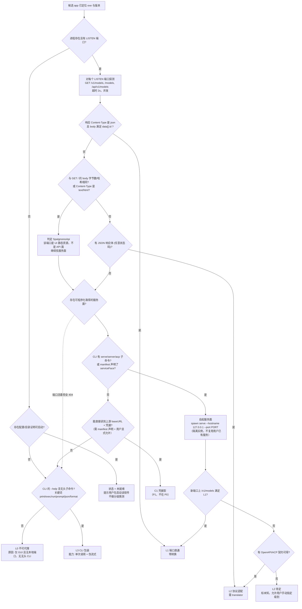
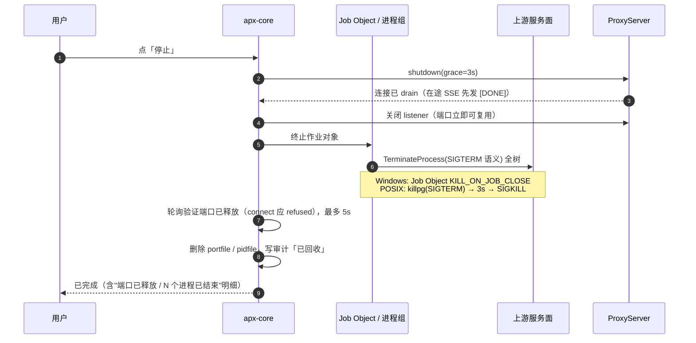
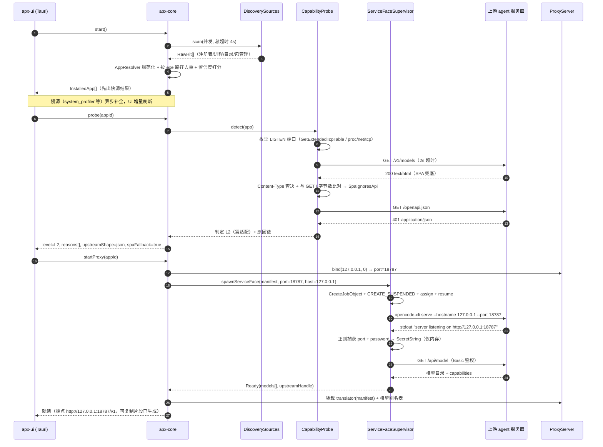
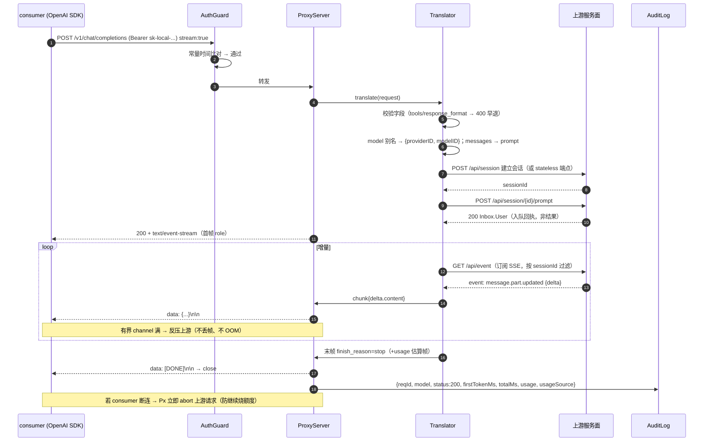
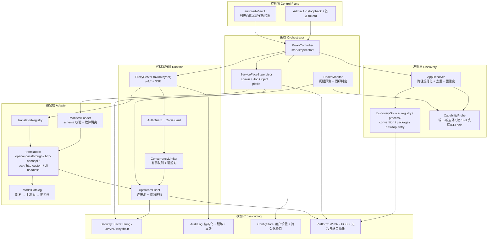
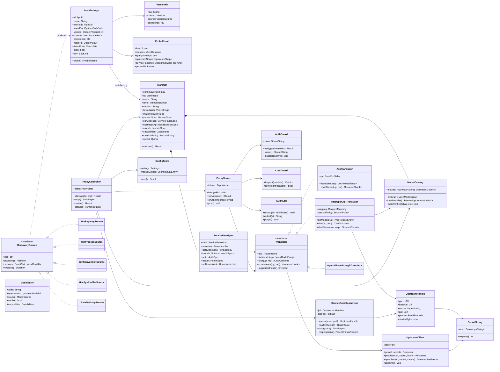
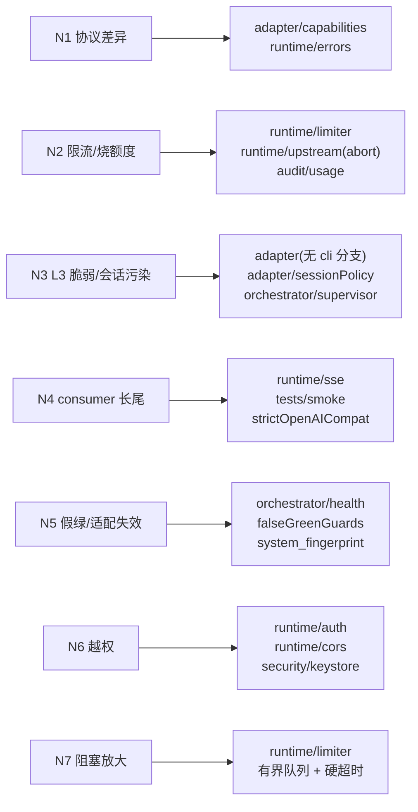

# 03 · 技术可行性分析与系统架构

| 项 | 内容 |
|---|---|
| Language | 简体中文 |
| 产品名 | 本地代理启动器（Agent Proxy Launcher） |
| Project Name | `agent_proxy_launcher` |
| 文档版本 | v1.0 |
| 需求基线 | `02-prd-delta.md`（v2）。`01-prd.md` 仅复用其风险清单与竞品分析；其「改写 agent baseURL」链路已废弃，本文不再涉及 |
| 文档定位 | 交付总监《可行性分析与项目规划报告》的技术主干；设计 + 里程碑 + 风险映射 |
| 目标平台 | P0 仅 Windows 11 x64；macOS / Linux 设计到位、实现排 P2（但识别矩阵必须给全，因为"通用性"是产品承诺） |

## 证据分级约定

本文所有平台机制、数值、命令都必须可追溯。标注规则：

| 标记 | 含义 |
|---|---|
| `[实-本]` | **本次（架构师）在本机亲自执行并取得原始输出**，附录 A 有原文 |
| `[实-总]` | 交付总监实测，已核实，本文引用其结论 |
| `[文档]` | 官方文档 / 公开协议规范 / 平台 API 文档 |
| `[待验]` | 合理推断，**未验证**，必须在 M0 spike 中闭合 |

> 凡出现 `[待验]` 的地方一律不得写进对外承诺，也不得作为里程碑验收的充分条件。这是本项目的纪律：**"有端口 ≠ 有 API"这个教训的本质是，不要把"看起来对"当成"验证过"。**

---

# A. 总体可行性结论

## A.1 一句话结论

**控制面（发现 → 端口/凭据获取 → 分级 → 模型清单 → 健康检查 → 端点托管 → 进程回收）在本机今日已可程序化跑通，可行性高；数据面（一次 consumer 请求真的穿到模型并逐 token 流回来）只完成了一半，关键的两个假设尚未闭合 —— 因此产品可行，但"M0 spike 是 Go/No-Go 闸门"必须被当作硬闸门，不能当形式步骤。**

## A.2 可行性分级表

| 能力块 | 可行性 | 依据 | 阻塞点 |
|---|---|---|---|
| 候选发现（多源扫描 + exe 路径去重） | **高** | `[实-总]` 注册表命中 7 款；`[实-本]` 从 `%LOCALAPPDATA%\Programs\ai.opencode.desktop` 拿到真实 exe | 无。工作量在平台差异，不在可行性 |
| 版本号获取 | **高** | `[实-总]` DisplayVersion 可靠；`version` 文件是 Electron 运行时版本（陷阱） | 需按来源分级 + 冲突仲裁 |
| 端口发现 | **中**（分路线） | `[实-本]` OpenCode：`service status` 直接打印 `http://127.0.0.1:28894`，**权威且无歧义**；`[实-总]` DSH：只能从进程反查 3082 | 没有 `service status` 这类子命令的软件，只能靠 LISTEN→PID 反查 + 端口归属判断，误判率高 |
| 服务面凭据获取 | **中** | `[实-本]` `~/.config/opencode/service.json` 只有 `password`（43 字符）；**用它对 `/openapi.json` 做 Bearer 是 401，做 `Basic base64("opencode:<password>")` 才是 200** | 鉴权方案逐厂商不同，必须由 manifest 声明；不可通用推断 |
| L0–L3 分级判定 | **高**（有坑但已定位） | `[实-本]` **致命坑已量化**：`/`、`/v1/models`、`/models`、`/doc`、`/config`、`/app`、`/model` **全部返回 `200 text/html` 且字节数完全相同（9571）**；真 API 面是 `/openapi.json` → 无凭据 `401 application/json` | 朴素"200 即 L1"会 100% 假绿。判定必须做**响应体形态 + 跨路径同构检测** |
| 模型清单获取 | **高** | `[实-本]` `GET /api/model` 返回结构化目录，含 `capabilities{tools,input,output,temperature}`、`variants`、`cost`；`opencode models` 输出 `provider/model` 全量列表 | 语法/字段逐厂商不同；别名映射需自建 |
| OpenAI 端点托管（`/v1/models`、`/v1/chat/completions`、SSE） | **高** | `[文档]` 已有成熟实现范式（axum/hyper + SSE） | 无技术不确定性，纯工程量 |
| 非流式单次生成（数据面） | **中**（未闭合） | `[实-本]` 端点存在且契约清晰：`POST /api/experimental/generate/text`，body `{prompt, model{id,providerID}}` → `{data:{text}}`；**但实测 60s 无返回**（需上游模型凭据） | 需 M0 用真实可用凭据重测；若拿不到 → 无 P0 样例 |
| 流式（逐 token） | **低→中**（最大不确定性） | `[实-本]` `prompt` 端点返回 JSON（非 SSE，异步入队语义）；流式只能走 `GET /api/event`（`text/event-stream`）+ 按 sessionID 过滤 | 需要"双通道 + 事件过滤 + 增量拼接"三件事同时成立；失败则降级伪流式 |
| `tool_calls` 双向转换 | **低（P0 不做）** | 上游契约里没有 OpenAI tool_calls 形态；`capabilities.tools:true` 是**上游自己的能力位**，不是协议兼容位 | 典型 N1 风险源。P0 明确返回结构化错误码，不做翻译 |
| 进程树回收（Electron 多进程 / 孤儿） | **高** | `[文档]` Windows Job Object `JOB_OBJECT_LIMIT_KILL_ON_JOB_CLOSE` + `CREATE_SUSPENDED` 先 assign 后 resume | 必须"先挂 Job 再跑"，否则有竞态窗口 |
| 通用性（不硬编码厂商） | **中**（需澄清 PRD 边界） | 见 §D.4.4：**"描述文件即适配"对发现/分级成立，对协议翻译不成立** | 必须把 translator 从 manifest 里显式建模出来，否则 G2 的承诺会在第 2 款软件崩掉 |

## A.3 "这台机器上现在能不能跑通？"——逐条诚实判断

不问"理论上能不能"，只问"此刻这台上能不能"：

| # | 问题 | 诚实回答 | 证据 |
|---|---|---|---|
| 1 | 现在能否发现本机 agent 并列出？ | **能。** 注册表 + 目录约定 + 进程三条源都可用 | `[实-总]` 7 款命中；`[实-本]` OpenCode exe 路径确认 |
| 2 | 现在能否找到某个 agent 的**真实可用**服务端口？ | **能，但只对 OpenCode 成立。** `opencode-cli service status` → `http://127.0.0.1:28894`，一行命令、无歧义 | `[实-本]` |
| 3 | 现在能否通过该端口拿到结构化模型清单？ | **能。** `GET /api/model`（Basic 鉴权）返回完整目录含能力位 | `[实-本]` |
| 4 | 现在能否端到端跑通一次模型调用？ | **不能确认。** 端点契约存在，但实测无返回（缺上游凭据/或 28894 的后台服务未持有凭据）。这是**唯一真正卡住 P0 的事实** | `[实-本]` 60s 超时 |
| 5 | 现在能否逐 token 流式？ | **不能。** 未取得任何 SSE 增量；`/api/event` 可订阅但事件到 OpenAI chunk 的映射未验证 | `[实-本]` 未测通 |
| 6 | 现有无"天然 OpenAI 兼容"的上游可当 L1？ | **本机没有。** 与 `[实-总]` E1 一致：Ollama(11434)/LM Studio(1234) 已装未运行，无监听 | `[实-本]` netstat 无 11434/1234 |
| 7 | DSH（DeepSeek Harness）能否代理？ | **目前 L0/L2 待定。** `0.0.0.0:3082` 是 Electron 静态资源服务器（42KB HTML，`/v1/models` 等全 404），**不是 API** | `[实-总]` E2 + `[实-本]` 同构现象复现在 OpenCode SPA 上 |

**结论**：控制面 6/7 条已通，数据面 0/2 条已通。所以——

> **产品不做"技术可行性待验证"，做"M0 spike 3 天闸门"。**
> 若 M0 结束时假设 H2（能拿到一次真实文本返回）与 H3（能拿到增量流）都不成立 → P0 无法交付"端到端可跑样例"，必须按 §E.2 的切换规则改路线（凭据型或 CLI 包装型），**且产品定位需重新向用户解释**。这个风险必须显式写进报告首页，不能藏在附录。

## A.4 本次新增实测证据（对 v1/v2 PRD 的增量，编号续 PRD 附录 E）

| # | 实测事实 | 架构含义（重要） |
|---|---|---|
| **E8** | `opencode-cli serve --hostname <h> --port <n> --cors <origin> --standalone --stdio` 存在，描述为 **"Start the v2 API and web server"** | 这类 agent **官方支持被程序化托管**：host/port 可指定 → 我们不必猜端口，**可以自己分配端口并用参数注入**。这是 L2 的理想形态 |
| **E9** | `opencode-cli service status` 输出 `http://127.0.0.1:28894`；`service get` 输出 `{}` | **端口发现的权威通道是子命令 stdout，不是配置文件**。`service.json` 里没有端口，与 `[实-总]` 7 条完全一致 |
| **E10** | `~/.config/opencode/service.json` = `{"password":"<43字符>"}`；HTTP **Bearer → 401**，`Basic base64("opencode:<password>")` → **200** | 鉴权方式必须 manifest 声明（`auth.type: basic` + `username: opencode`），**不能假设 Bearer**。凭据"可读"不等于"可用" |
| **E11** | 无凭据探测：`/openapi.json` → `401 application/json {"_tag":"UnauthorizedError"}`；而 `/`、`/v1/models`、`/models`、`/doc`、`/config`、`/app`、`/model` **一律 200 text/html，字节数全等于 9571** | **SPA 兜底是假绿的头号成因，且可被廉价检测**：① `Content-Type` 非 `application/json` → 否决；② 与 `/` 响应**字节数相同 / 内容哈希相同** → 判定"SpaFallback"→ 直接降为 L2 待定。这条要写成 `Detector` 的第一原则 |
| **E12** | `GET /openapi.json` 有凭据时返回 **350,880 字节**规范；路径含 `/api/session/{id}/prompt`、`/api/session/{id}/generate`、`/api/experimental/generate/text`、`/api/event`(SSE)、`/api/model`、`/api/provider` | 上游契约**机器可读**。适配器可以"读 OpenAPI 规范 + 声明映射"，而不是硬编码逆向。规范已归档：`docs/evidence-opencode-openapi.json` |
| **E13** | `POST /api/experimental/generate/text` 请求 `{prompt:string, model{id,providerID}}` → 响应 `{data:{text:string}}`；`POST /api/session/{id}/prompt` → 返回 `Session.Inbox.User`（**入队回执，不是结果**）；`GET /api/event` 是唯一 `text/event-stream` | **无状态与有状态是两个不同的上游面**，且流式只在事件通道上。→ 强制引入 `sessionPolicy` 概念（见 §C.4.8） |
| **E14** | `GET /api/model` 每项含 `id / modelID / providerID / type / capabilities{tools,input,output,temperature} / variants[{id,settings.reasoningEffort}] / cost[] / settings.baseURL` | **能力协商表可以自动生成**，不必手写。`variants.reasoningEffort` 映射到 `reasoning_effort`；`capabilities.tools` 直接驱动"是否接受 `tools` 字段" |
| **E15** | `opencode-cli run <msg> --format {default,json} --model provider/model --agent --thinking` | L3 CLI 包装有官方无头入口；且 `--model` 语法是 `provider/model` → **模型别名映射必须支持"带 provider 前缀"与"不带"的双向解析** |
| **E16** | 我用 `serve` 起进程，**命令结束（父 shell 退出）后 18787 端口即消失**；但后台服务 28894 的生命周期独立于我的进程 | ① 说明"父进程死 → 子进程跟着死"在某些宿主下是**偶然成立**，不能依赖；必须显式 Job Object。② 说明**必须区分"我起的服务面实例"与"用户 GUI 已有的服务面实例"**，绝不接管后者（否则下游流量混入用户会话） |
| **E17** | `~/.codex/.codex-global-state.json` 已达 **632 KB**；`~/.cc-switch` 里配置已从 `settings.json`(v1 观察) 演化成 `cc-switch.db`(1.6MB SQLite) | 支撑两条设计结论：① "读配置文件拿端口/key"这条路**不可靠**（配置即数据库）；② 竞品在演进，我们的差异化必须锁在"探测 + 分级 + 端点托管"，不要碰配置 |

---

# B. 跨平台识别矩阵（本文重点）

## B.1 总矩阵：3 平台 × 5 类手段

行 = 识别手段，列 = 平台。每格给**具体机制**，不给"通过系统 API"。

| 识别手段 | Windows 11 | macOS | Linux |
|---|---|---|---|
| **1. 安装路径** | ① 注册表 Uninstall 三视图：`HKLM\SOFTWARE\Microsoft\Windows\CurrentVersion\Uninstall\*`（64 位）、`HKLM\SOFTWARE\WOW6432Node\Microsoft\Windows\CurrentVersion\Uninstall\*`（32 位）、`HKCU\SOFTWARE\Microsoft\Windows\CurrentVersion\Uninstall\*`（用户级/绿色版安装器）。键值取 `DisplayName` / `DisplayVersion` / `InstallLocation` / `DisplayIcon` / `Publisher` / `UninstallString` / `InstallDate` / `SystemComponent`（用于过滤）<br>② `HKLM\SOFTWARE\Microsoft\Windows\CurrentVersion\App Paths\*.exe`（**直接给可执行文件绝对路径，比 InstallLocation 更可靠**）<br>③ `%LOCALAPPDATA%\Programs\*`（Electron 常规落地，`[实-本]` OpenCode 在此）<br>④ `%ProgramFiles%` / `%ProgramFiles(x86)%` / `%APPDATA%` 一层目录枚举<br>⑤ 开始菜单 `.lnk`：`%ProgramData%\Microsoft\Windows\Start Menu\Programs\**\*.lnk`、`%APPDATA%\Microsoft\Windows\Start Menu\Programs\**\*.lnk`，用 COM `IShellLinkW::GetPath` 解析目标<br>⑥ `HKCU\Software\Classes\Local Settings\Software\Microsoft\Windows\Shell\MuiCache`（**曾运行过的 exe 全路径**，绿色版唯一线索）<br>⑦ `HKCU\...\Explorer\FeatureUsage\AppSwitched`（使用频次，可用于排序） | ① `/Applications/*.app/Contents/Info.plist`、`~/Applications/*.app`、`/Applications/Utilities/*.app` — 取 `CFBundleIdentifier` / `CFBundleShortVersionString` / `CFBundleVersion` / `CFBundleExecutable` / `LSMinimumSystemVersion`<br>② **`system_profiler SPApplicationsDataType -json`（一次性枚举全机已安装 app，含 `path`/`version`/`obtained_from`/`arch_kind`，无需权限，是 macOS 的"注册表"）**<br>③ `mdfind "kMDItemContentType == 'com.apple.application-bundle'"`（Spotlight，秒级）<br>④ Homebrew Cask：`/opt/homebrew/Caskroom/<cask>/<version>/`、`/usr/local/Caskroom/`，或 `brew list --cask --versions`<br>⑤ `~/Library/Application Support/<bundle-id>/`、`~/Library/Containers/<bundle-id>/`（沙盒）存在性反推<br>⑥ `pkgutil --pkgs` + `pkgutil --files <pkgid>`（pkg 安装的产品） | ① `/usr/share/applications/*.desktop`、`/usr/local/share/applications/*.desktop`、`~/.local/share/applications/*.desktop`、`/var/lib/flatpak/exports/share/applications/` — 解析 `[Desktop Entry]` 的 `Name` / `Exec`（**需处理 `%f %U %F` 字段码与 `env A=B cmd` 前缀**）/ `TryExec` / `NoDisplay` / `Categories`<br>② `/opt/*/`（第三方 agent 常见落点）、`/usr/local/bin`、`~/bin`、`~/.local/bin`<br>③ 包管理器：`dpkg-query -W -f='${Package}\t${Version}\t${Status}\n'`、`rpm -qa --qf '%{NAME} %{VERSION}-%{RELEASE}\n'`、`pacman -Q`、`snap list`、`flatpak list --app --columns=application,version`、NixOS `readlink -f /run/current-system/sw` <br>④ AppImage：`~/Applications/*.AppImage`、`~/bin/*.AppImage`（**无包管理器记录，只能靠文件扫描**）<br>⑤ `update-alternatives --get-selections`（多版本共存时的当前指向） |
| **2. 配置文件** | ① 用户 dotfile：`~/.dsh/`、`~/.config/opencode/`、`~/.claude/`、`~/.codex/`、`~/.zcode/`、`~/.minimax/`、`~/.cc-switch/` `[实-总][实-本]`<br>② `%APPDATA%\<vendor>\`<br>③ `%LOCALAPPDATA%\<vendor>\`<br>④ 注意：**Electron 会把真实配置塞进 `%APPDATA%\<app>\.electron-profile\` 下的 LevelDB/SQLite**（`[实-总]` E6），不可解析 | ① `~/Library/Application Support/<bundle-id>/`<br>② `~/Library/Preferences/<bundle-id>.plist`（**读时用 `defaults read <bundle-id>`，直接读文件会被 `cfprefsd` 缓存欺骗**）<br>③ `~/Library/Containers/<bundle-id>/Data/`（沙盒 app）<br>④ `~/Library/Group Containers/`<br>⑤ `~/.config/<name>/`（跨平台 CLI，越来越多）<br>⑥ `~/.<name>/` dotfile 兼容层 | ① `~/.config/<name>/`（XDG_CONFIG_HOME，必须尊重环境变量而非硬编码 `~`）<br>② `~/.local/share/<name>/`（XDG_DATA_HOME）<br>③ `~/.<name>/` 兼容层<br>④ `$XDG_STATE_HOME/<name>/`<br>⑤ 系统级 `/etc/<name>/`（只读） |
| **3. 进程** | ① 枚举：`CreateToolhelp32Snapshot(TH32CS_SNAPPROCESS)` → `PROCESSENTRY32{th32ProcessID, th32ParentProcessID, szExeFile}`（**只有文件名，无全路径**）<br>② 取全路径：`OpenProcess(PROCESS_QUERY_LIMITED_INFORMATION)` → `QueryFullProcessImageNameW`（同用户可用；失败退 `NtQueryInformationProcess`+`ProcessImageFileName`）<br>③ 父进程链：用 `th32ParentProcessID` 上溯到 `explorer.exe` / `services.exe` / `wininit.exe` / `svchost.exe` → **用于区分主进程与渲染进程**<br>④ 窗口判定：`EnumWindows` + `GetWindowThreadProcessId` + `IsWindowVisible` + `GetWindowTextLengthW` → 有可见顶层窗口的才是"GUI 主进程"<br>⑤ 会话：`ProcessIdToSessionId`（跨 session 0 的排除）<br>⑥ 备选：WMI `SELECT ProcessId,ParentProcessId,ExecutablePath,CommandLine FROM Win32_Process`（**需要管理员，且 Win11 起 `wmic` 已弃用 → 用 COM/`windows` crate 直连 WMI**） | ① `proc_listallpids()` + `proc_pidinfo(PROC_PIDTBSDINFO)` 拿 `pbi_ppid`/`pbi_comm`<br>② **`proc_pidpath(pid, buf, PROC_PIDPATHINFO_MAXSIZE)` 拿可执行文件全路径**（不要用 `ps`，`comm` 会被截断）<br>③ `sysctl(KERN_PROC_ALL)` 备选<br>④ `launchctl list`（带 `PID` 列，能识别 LaunchAgent/LoginItem 托管的常驻服务）<br>⑤ `ps -axo pid,ppid,uid,command`<br>⑥ 归一化：`Bundle.main.bundleURL` 反查时，把 `<App>.app/Contents/MacOS/<bin>` 归一到 `.app` 层级，否则同一 app 的 Helper 会被当独立产品 | ① `/proc/<pid>/exe`（`readlink`；注意 `" (deleted)"` 后缀 = 已升级但进程未重启 → **这是天然"需重启"信号**）<br>② `/proc/<pid>/cmdline`（NUL 分隔，`tr '\0' ' '` 可读）<br>③ `/proc/<pid>/cwd`（Electron 主进程的 cwd 常是 app 根）<br>④ `/proc/<pid>/status` 取 `PPid`、`Uid`<br>⑤ `ps -eo pid,ppid,comm,args`<br>⑥ 归一化：`/snap/<name>/current/...` → 归一为 `snap:<name>`；`/proc/<pid>/exe` 落在 squashfs 时用 `snap list` 反查<br>⑦ **`/proc/<pid>/environ` 绝对不读**（含明文 API key，见 §B.7） |
| **4. 版本** | ① **主：注册表 `DisplayVersion`**（`[实-总]` 唯一可靠来源）<br>② 备：文件版本资源 `GetFileVersionInfoSizeW` → `GetFileVersionInfoW` → `VerQueryValueW(L"\\")` 取 `VS_FIXEDFILEINFO.dwFileVersionMS/LS`，及 `\StringFileInfo\<lang><cp>\ProductVersion`<br>③ 备：`DisplayIcon` / `UninstallString` 里的路径含版本号（如 `%APPDATA%\ai.opencode.desktop\cli\22.2.5-x64\`）<br>④ **禁用：安装目录下的 `version` 文件**——`44.7.0` 是 Electron 运行时版本，不是应用版本（`[实-总]` 已证实）<br>⑤ 冲突仲裁：注册表 > 文件版本资源 > 路径片段 > 一律标注来源与置信度 | ① `Info.plist` 的 `CFBundleShortVersionString`（**用户可见版本，优先**）+ `CFBundleVersion`（build 号）<br>② `mdls -name kMDItemVersion /Applications/X.app`<br>③ `defaults read /Applications/X.app/Contents/Info CFBundleShortVersionString`（自动处理 binary plist）<br>④ Homebrew Cask 目录名即版本<br>⑤ `<bin> --version` 兜底<br>⑥ 冲突仲裁：`CFBundleShortVersionString` > `kMDItemVersion` > `--version` | ① 包管理器：`dpkg-query -W -f='${Version}' <pkg>`，且可用 `dpkg -S <exe路径>` 反查所属包与版本（**最强**）<br>② `rpm -qf <path> --qf '%{VERSION}-%{RELEASE}'`<br>③ `<bin> --version`（**带 2s 超时 + stdout/stderr 都收 + 正则抽第一个 `\d+\.\d+(\.\d+)?`**；很多 CLI 把版本打到 stderr）<br>④ AppImage：`<app>.AppImage --version`，或文件名里的版本片段<br>⑤ 冲突仲裁：包管理器 > `--version` > 文件名 |
| **5. 服务端口** | ① **`GetExtendedTcpTable(..., TCP_TABLE_OWNER_PID_LISTENER, ...)`（AF_INET 与 AF_INET6 各调一次）→ 直接拿 `{localAddr, localPort, owningPid}`**，无需特权（比 `netstat -ano` 快一个量级且不受本地化影响）<br>② UDP：`GetExtendedUdpTable(UDP_TABLE_OWNER_PID)`（部分推理服务用 UDP 发现）<br>③ 端口→应用：端口记录的 `owningPid` → `QueryFullProcessImageNameW` → exe 路径 → 归一到候选条目<br>④ **绑定地址判定**：`localAddr == 0.0.0.0` 说明已暴露到局域网（`[实-总]` DSH 3082 就是），需在 UI 提示风险<br>⑤ 反向（我们自己起的服务面）：先 `TcpListener::bind(("127.0.0.1", 0))` 再 `local_addr().port()` | ① `lsof -nP -iTCP -sTCP:LISTEN`（需权限；无权限时降级 `netstat -anv -p tcp`）<br>② 程序内：`proc_pidinfo(PROC_PIDLISTFDS)` → `PROC_PIDLISTFDS` 数组 → 对每个 fd 调 `proc_pidfdinfo(PROC_PIDFDVNODEPATHINFO / PROC_PIDFDSOCKETINFO)` 取 `soi_proto.pri_tcp.tcpsi_ini.insi_lport`（**无需 root，这是 macOS 上正确的做法**）<br>③ 绑定地址：`insi_laddr` 全 0 = `0.0.0.0` | ① **`/proc/net/tcp` + `/proc/net/tcp6` 解析**：第 2 列 `HEXIP:HEXPORT`（小端序！），第 4 列状态 `0A` = LISTEN，第 10 列是 socket inode<br>② inode → PID：扫 `/proc/*/fd/*` 的 symlink 找 `socket:[<inode>]`（**无 root 唯一可行路径**）<br>③ 有 root 时用 `ss -ltnp` 更快<br>④ `ss -ltn state listening`（不带 `-p` 避免权限告警污染输出）<br>⑤ 容器/沙盒：`/proc/<pid>/net/tcp` 是 **namespace 内视图**，与宿主机不同 → 需要读 `/proc/1/root/proc/net/tcp` 对比 |

### B.1.1 三平台手段的"可信度 vs 成本"取舍结论

| 平台 | P0 必做的源 | 可以不做 | 理由 |
|---|---|---|---|
| Windows | Uninstall 注册表（三视图）、`%LOCALAPPDATA%\Programs`、进程 + `QueryFullProcessImageNameW`、`GetExtendedTcpTable`、`App Paths`、`MuiCache` | 开始菜单 `.lnk` 解析（P2，成本高收益低：MuiCache 已覆盖大部分曾运行场景） | MuiCache 弥补了 InstallLocation 为空的问题，`.lnk` 的边际收益低 |
| macOS | `system_profiler SPApplicationsDataType -json`、`Info.plist`、`LaunchAgents/launchctl list`、`proc_pidpath`、`proc_pidfdinfo` | Homebrew Cask 目录扫描（`system_profiler` 已覆盖） | `system_profiler` 一条命令顶三条源 |
| Linux | `.desktop` 解析、包管理器查询、`/proc/<pid>/exe`、`/proc/net/tcp`+fd 扫描 | AppImage 扫描（P2）、snap/flatpak 详情 | 桌面环境差异大，.desktop 是最大公约数 |

## B.2 Windows 关键机制的实现要点（给工程师的落点）

| 关注点 | 正确做法 | 错误做法（会踩坑） |
|---|---|---|
| 读注册表 | Rust `windows` crate / `winreg` crate 直接 `RegOpenKeyExW` + `RegEnumKeyExW` + `RegQueryValueExW`；显式传 `KEY_WOW64_64KEY` 与 `KEY_WOW64_32KEY` 各读一遍 | ① shell 出 `reg.exe`（本地化输出、% 转义、编码、慢，且企业策略可能禁用）② 只读一个视图（漏 32 位安装的产品） |
| 拿进程全路径 | `OpenProcess(PROCESS_QUERY_LIMITED_INFORMATION)` + `QueryFullProcessImageNameW` | 用 `szExeFile`（只有文件名）；用 WMI（需管理员）；用 `GetModuleFileNameEx`（需 `PROCESS_VM_READ`，权限更高、易失败） |
| 判断"主进程" | 父进程是 `explorer.exe` / 无父 / 是整棵树的根；且 `EnumWindows` 有可见顶层窗口 | 按进程名计数（Electron 8 个同名，`[实-总]` F3） |
| 判断"端口属于谁" | `GetExtendedTcpTable` 的 `owningPid` → 反查 exe 路径 → 归一 | 只判断端口是否 LISTEN（无法回答"是谁在听"，也无法在 3082 被占时告诉用户是哪款软件） |
| 端口是否被占用（我们要 bind 前） | `TcpListener::bind` 试绑，失败即冲突；**端口预检与真正 bind 之间的 TOCTOU 用"先 bind 后配置"消除**：先 `bind(0)` 拿端口，再把它交给 HTTP server，全程不释放 | 先 `netstat` 判空闲 → 再 bind（两次系统调用之间有窗口期） |
| 进程树回收 | `CreateJobObjectW` → `SetInformationJobObject(JobObjectExtendedLimitInformation, {LimitFlags: JOB_OBJECT_LIMIT_KILL_ON_JOB_CLOSE})`；子进程用 `CREATE_SUSPENDED` 创建 → `AssignProcessToJobObject` → `ResumeThread` | 直接 `TerminateProcess` 父进程（Electron 的 5–8 个子进程会变孤儿）；`taskkill /T`（依赖进程树未被 reparent） |
| 文件版本 | `GetFileVersionInfoSizeW` + `GetFileVersionInfoW` + `VerQueryValueW` | 解析 PE 资源手动读（无必要） |

## B.3 macOS 关键机制要点

| 关注点 | 正确做法 | 坑 |
|---|---|---|
| 全量枚举 | `system_profiler SPApplicationsDataType -json` 一条命令拿到 `_name/path/version/obtained_from/arch_kind/info` | 输出 3–8 MB，需流式 JSON 解析、不能整串读进内存再 parse |
| plist 读取 | `plist` crate 支持 `bplist00` 二进制格式；或调 `defaults read` | 当文本读（二进制 plist 会解析失败）；直接读 `~/Library/Preferences/*.plist` 而不经 `defaults`（`cfprefsd` 有缓存，可能读到旧值） |
| 进程全路径 | `proc_pidpath` | `ps -o comm`（会截断到 16 字符） |
| 端口归属 | `proc_pidinfo(PROC_PIDLISTFDS)` + `proc_pidfdinfo(PROC_PIDFDSOCKETINFO)` | 依赖 `lsof`（未安装于精简系统）、依赖 root |
| 服务常驻 | `launchctl list` + `~/Library/LaunchAgents/*.plist` 的 `Label`/`ProgramArguments` | 只扫 `/Applications`（漏 LaunchAgent 托管的 CLI agent） |
| 应用归一 | `<X>.app/Contents/MacOS/<bin>` 与 `<X>.app/Contents/Frameworks/*.app` 都归一到**最外层** `.app` | 把 Electron Helper / 内嵌 Framework 当独立条目 |
| 签名/防仿冒 | `codesign -dv --verbose=4 <app>` 取 `Identifier`/`TeamIdentifier`/`Authority`；`spctl -a -vv` 判断公证 | 只按名字匹配（同名仿冒 `.app` 会被误认） |

## B.4 Linux 关键机制要点

| 关注点 | 正确做法 | 坑 |
|---|---|---|
| `.desktop` 解析 | 按 Desktop Entry Spec：`Exec=` 要做**分词**（不是按空格 split——存在引号与转义），剥掉 `%f %F %u %U %i %c %k` 字段码，剥掉 `env VAR=val` 前缀；`TryExec` 指向的路径存在性是"真的装了"的更强信号；`NoDisplay=true` 通常应排除 | 按空格切 `Exec`（带空格的路径会断）；忽略 `%` 字段码（拿到的路径带 `%U` 无法执行） |
| 包查询 | 先探测发行版（`/etc/os-release` 的 `ID`/`ID_LIKE`），再选 `dpkg-query` / `rpm` / `pacman` | 假设有 `dpkg`（Fedora/Arch 没有） |
| 进程全路径 | `/proc/<pid>/exe` 的 `readlink` | 忽略 `" (deleted)"` 后缀（升级后未重启，路径已失效 → 应作为"建议重启上游"信号） |
| 端口归属（无 root） | 解析 `/proc/net/tcp{,6}` + 扫 `/proc/*/fd/*` 的 `socket:[inode]` | 直接 `ss -p`（非本用户进程不显示 PID，静默返回空） |
| 端口字节序 | `/proc/net/tcp` 的地址与端口是**小端十六进制**，必须两两交换字节 | 直接 `int(hex,16)`（得到错误端口，如 `1F90`(8080) 被算成 8080 之外的怪值——实际 `1F90` 就是 8080，但 `0A` 状态之类容易混乱，必须写单测） |
| 容器/沙盒 | 比较 `/proc/1/root/proc/net/tcp` 与 `/proc/net/tcp` | 忽略 namespace 隔离 |

## B.5 识别置信度模型

每个 `InstalledApp` 必须携带 `sources: [{kind, confidence, evidence}]`，最终 `confidence = max(单源置信度)` 而不是求和（避免"三源都很弱 → 合起来看着像很强"）。

| 来源 | 置信度 | 分数 | 说明 |
|---|---|---|---|
| 注册表 Uninstall + 非空 `DisplayVersion` + 非空 `InstallLocation` 且路径存在 | **高** | 0.95 | Windows 最强组合 |
| 注册表 Uninstall 但 `InstallLocation` 空，且由 **进程全路径** 补齐 | **高** | 0.90 | `[实-总]` OpenCode/ZCode/MiniMax 属此类；**必须标 `pathSource: process`** |
| `App Paths` 命中 | **高** | 0.90 | 直接给 exe 绝对路径 |
| `system_profiler SPApplicationsDataType` 命中（macOS） | **高** | 0.95 | 等价于注册表 |
| 包管理器命中 + 能定位二进制（Linux） | **高** | 0.90 | `dpkg -S` 反查成功加分 |
| `.desktop` 的 `Exec`/`TryExec` 指向存在的可执行文件 | **中高** | 0.80 | 只是"桌面入口存在" |
| `MuiCache` / `AppSwitched`（曾运行记录） | **中** | 0.65 | 路径可信，但可能已卸载 |
| dotfile 目录存在（`~/.dsh/`、`~/.zcode/`） | **中** | 0.60 | 证明"用过"，不证明"装着、能跑" |
| 进程路径反查（无任何安装记录） | **中** | 0.60 | 绿色版/免安装；路径可信、身份不可信 |
| 目录命名约定（`%LOCALAPPDATA%\Programs\<x>`、`/opt/<x>`） | **低** | 0.35 | 纯猜测，只作"候选建议" |
| `.lnk` 名称模糊匹配 | **低** | 0.30 | 同上 |
| 文件名/路径字符串包含关键词（`agent`、`assistant`） | **极低** | 0.15 | **禁止作为唯一来源**，只能进"可能是"分组 |

**呈现规则**（直接可验收）：

| `confidence` | UI 呈现 | 默认行为 |
|---|---|---|
| ≥ 0.85 | 「已识别」正常展示，可一键配置 | 参与自动分级探测 |
| 0.55–0.85 | 「已识别·路径来源=进程/曾运行记录」+ 黄色小标 | 参与探测，但探测结果标「推定」 |
| 0.30–0.55 | 折叠分组「可能的 agent（需要你确认）」 | **不自动探测**（避免对未知进程发 HTTP） |
| < 0.30 | 「低置信候选」+ 默认隐藏 | 仅手动展开 |

> 硬约束：**`confidence < 0.55` 的条目不得自动向其端口发任何 HTTP 请求。** 理由：我们不能替用户去探测一个身份不明的进程，这既是安全也是礼貌。

## B.6 误判处理

| 情形 | 具体表现 | 处置策略 | 是否给用户看 |
|---|---|---|---|
| **同名不同产品** | 两个厂商都叫 "Code"、"Harness"；macOS 有仿冒同名 `.app` | 去重主键 = **`(规范化 exe 绝对路径)`**，绝不按名字；同名不同路径 → 显示为两条并用**目录名/Publisher/签名**做副标题区分；macOS 额外用 `TeamIdentifier` 判定是否同一发行方 | 是，副标题展示区分依据 |
| **绿色版/便携版无注册表** | 只有一个 exe，双击即用 | 三条兜底：① `MuiCache`（Windows）；② 进程反查（在跑就有）；③ 用户手动添加。**手动添加必须是一等公民**：可指定 exe/命令 + 自定义 manifest | 是，空状态页给"手动添加"入口 |
| **多版本共存** | 同一产品装 2 个版本（`cli\22.2.5-x64\` 与 `cli\22.6.0-x64\`） | 按 exe 路径去重后，**同产品多版本分组一行**，展开选默认版本；默认取注册表 `DisplayVersion` 对应者，否则取 mtime 最新 | 是，展开可见 |
| **同一 app 的多进程**（Electron） | OpenCode 8 进程 / DSH 5 进程 | 按路径去重 → 1 条；进程内再按"有可见窗口 / 父进程为根"挑出主进程，标 `mainPid` | UI 只显示 1 条；详情页可看 PID 列表 |
| **进程存活但 exe 已删除**（升级未重启） | Linux `exe → " (deleted)"`；Windows 路径不存在 | 标 `stale: true` + 提示「软件已升级，建议重启后再代理」；**不自动信任其端口** | 是 |
| **snap/flatpak 挂载路径** | `/snap/x/12/usr/bin/x` | 归一为 `snap:x`，包管理器取版本 | 否，内部归一 |
| **商店/别名启动器**（`WindowsApps`） | `%LOCALAPPDATA%\Microsoft\WindowsApps\x.exe` 是 reparse point，不是真 exe | 解析 reparse target；解不出则标「应用商店应用，暂不支持」 | 是，明确说明不支持 |

### B.6.1 WSL 内的 agent 算不算「本机」？——**结论：不算，P0 明确排除**

理由（三条，任一都足以否决）：

1. **网络语义不一致**：WSL2 是 NAT 虚拟机。Windows 侧访问 WSL 内监听端口需 `localhostForwarding`（可能被 `.wslconfig` 关掉），而 WSL 内访问 Windows 侧 `127.0.0.1` 在多数配置下**不通**（需 `mirrored` 网络模式或读 `/etc/resolv.conf` 的网关 IP）。而产品的核心承诺是"`127.0.0.1` 上的标准端点"，跨这层边界后**"本机"这个词的含义就变了**，与 N6（只服务本机）的边界定义冲突。
2. **生命周期语义不一致**：WSL 的进程由 `wsl.exe` 的发行版实例托管，可能随最后一个终端关闭被终止（`vmIdleTimeout`），也可能长活。Windows Job Object 管不到 WSL 内的进程树 → **"停止即回收"无法保证**，而这是 P0-8 的硬验收。
3. **识别语义不一致**：`\\wsl$\<distro>\...` 路径不是 Win32 路径，`GetExtendedTcpTable` 看不到 WSL namespace 内的监听端口。要支持就得写第二套发现器 + 第二套进程管理 + 一套网络桥接。

**落实方式**：发现层显式检测 WSL 环境（`/proc/version` 含 `microsoft`；`\\wsl$` UNC 可达；`wsl.exe -l -v` 可执行），命中则在 UI 显示一次性说明「检测到 WSL，其中的 agent 不在本版本支持范围内（原因：跨网络命名空间，无法保证端口与进程生命周期）」，**并把它作为 `L0` 之外的第 5 种状态 `EXCLUDED`**，不进 L0–L3 分级。

## B.7 配置探测的「只读安全」原则

产品**不写**任何第三方配置（P0 硬约束，见交付总监裁决）。但"只读"本身也有风险，因此定 5 条原则：

| # | 原则 | 具体做法 | 反例（禁止） |
|---|---|---|---|
| R1 | **只读、绝对不写** | 以 `FILE_SHARE_READ` 打开（Windows）/ `O_RDONLY`（POSIX）；**不创建锁文件、不打时间戳、不 unlink**；连 `.bak` 都不写 | 「顺便修一下格式」；写 `settings.json.tmp` |
| R2 | **不解析含密钥的字段值** | 白名单字段名读取：`baseURL`/`api`/`provider`/`type`/`models`/`port`/`host` 等；命中 `key|token|secret|password|credential|auth|apiKey|appSecret|private` 的键，**值一律不读进内存**，只记"存在 + 长度 + 类型" | 把整个 YAML `parse` 成 map 再 grep（污染内存、进崩溃日志、进 telemetry） |
| R3 | **结构未知即降级为存在性判断** | YAML/JSON 解析失败、或顶层结构不符合已知形态、或文件 > 2 MB → **只报"存在 `~/.dsh/settings.yaml`"与 mtime/size，标 `schemaUnknown`，不再深入** | 猜字段名、猜嵌套层级 |
| R4 | **不跨用户、不提权** | 只读当前用户目录；`C:\ProgramData`、`/etc` 等系统级配置只读且需明确权限；**永不**为了读配置而请求 UAC/sudo | 以管理员身份读别人的 `~/.claude/settings.json` |
| R5 | **凭据获取是独立能力，受独立开关控制** | 读取凭据（如 `service.json` 的 `password`）**只在"通道型/凭据型适配器需要鉴权"时发生**，且：① 只在内存；② 立即封装为 `SecretString`（`Debug` 打码、不 `Clone`、不 `serde::Serialize`）；③ 生命周期 = 本次上游会话；④ UI 只显示 `已获取（43 字符）` | 把 key 写进日志、写进 UI 表单明文、写进崩溃转储 |

**架构上的落实**：`ConfigProbe` 接口**返回类型里根本没有 `String` 裸值**，只有 `ConfigFinding { path, exists, size, mtime, schemaState, redactedKeys[], safeFields: BTreeMap<String, SafeValue> }`。类型系统层面让"泄漏"写不出来，比靠 review 更可靠。

## B.8 跨平台抽象（DiscoverySource 统一接口）

```rust
// 每个平台提供自己的实现；上层的合并/去重/打分逻辑与平台无关
pub trait DiscoverySource: Send + Sync {
    fn id(&self) -> &'static str;              // "win.registry", "mac.apps", "linux.desktop"
    fn platform(&self) -> Platform;
    fn scan(&self, ctx: &ScanCtx) -> Result<Vec<RawHit>, ScanError>;
    fn timeout(&self) -> Duration;             // 默认 3s，防单个源拖死首屏
}

pub struct RawHit {
    pub name: String,
    pub exe_path: Option<PathBuf>,             // 绝大多数源能给到这部分
    pub install_dir: Option<PathBuf>,
    pub version: Option<VersionHit>,           // 带 source + confidence
    pub publisher: Option<String>,
    pub evidence: Evidence,                    // 原始键值/路径/命令，用于 UI "来源" 展开
    pub confidence: f32,
}
```

**合并算法**（`AppResolver`）：

1. 每个 `RawHit.exe_path` 做**规范化**：`\\?\` 前缀剥离、`short 8.3 名`展开、`..` 归一、大小写归一（Windows）、`/private/var` → `/var`（macOS）、symlink 解析（Linux 但保留原路径用于展示）。
2. 按规范化路径分组 → 每组一个 `InstalledApp`。
3. 组内 `field` 级择优：`version` 取置信度最高者（同级取注册表 > 文件资源 > 参数）；`name` 取最长且非全大写的；`installDir` 取最短公共前缀。
4. 无 `exe_path` 的 `RawHit`（只有 InstallLocation）→ 去该目录下找 `*.exe`/可执行位文件，**只认 manifest 声明的候选名**（避免把 `uninstall.exe` 当主程序）。
5. 输出 `InstalledApp { id: 路径哈希, sources[], confidence, mainPid?, listenPorts[] }`。

> 首屏性能预算：全部源并发跑，**总超时 4s**；`system_profiler` 这类慢源（macOS 3–6s）改为「异步补全」——先出快源结果，慢源回来后再增量刷新 UI。这条写进 M1 验收。

---

# C. 代理的技术实现方式

## C.1 三条路线

三条路线不是"实现细节差异"，而是**三种不同的产品**：它们决定产品是"复用 agent 的大脑"还是"借用 agent 的通道"。必须先认清这一点再选。

| 维度 | ① 通道型 through-agent | ② 凭据型 borrow-credentials | ③ CLI 包装型 cli-wrap |
|---|---|---|---|
| **数据路径** | consumer → 代理 → **agent 服务面**（ACP / 自带 OpenAPI server / `--server`）→ agent 编排 → 模型 | consumer → 代理 → **直接打上游 provider**（读 agent 配置里的 `baseURL`+`key`）→ 模型 | consumer → 代理 → `spawn(<agent> --prompt ... --print/--format json)` → 进程输出 → 代理 |
| **复用 agent 的什么** | **编排、工具、MCP、会话、权限、系统提示**（这是"agent"的价值） | **什么都不复用**，只白拿一个上游地址与凭据 | 编排 + 工具全都有，但每次冷启动 |
| **协议标准化程度** | ACP 是**公开标准**（JSON-RPC over stdio，`session/new`/`session/prompt`/`session/update`）；自带 server 是**厂商私有**但常有 OpenAPI | 就是 OpenAI/Anthropic 原生协议 → **零翻译** | 无协议，只有 stdin/stdout 文本 |
| **流式能力** | ACP：`session/update` 增量通知 → **真流式**；私有 server：看是否有 SSE（`[实-本]` OpenCode 有 `/api/event`） | **原生 SSE，最真** | 无真流式，只能伪流式 |
| **稳定性** | 中：依赖上游进程常驻、端口/凭据动态、协议可能随版本变（N5） | **高**：只依赖一个 HTTP 上游 | **低**：CLI 参数、输出格式、登录态、并发模型都会变 |
| **性能** | 中：多一跳进程内编排；首 token 可能被 agent 的系统提示拖慢 | **高**：直连 | 低：每次冷启 1–5s |
| **`tool_calls` / `usage`** | 基本拿不到 OpenAI 形态 | **原生有** | 无 |
| **上下文语义** | 上游有会话状态 → 可能污染用户会话 | 无状态，天然匹配 chat completions | 无状态 |
| **凭据/合规风险** | **低**（不碰 key，不碰上游 ToS；用户自己的 agent 自己已登录） | **高**：读明文 key（S1）、绕过 agent 编排、可能违反上游 ToS（C2/C3） | 中：不改配置，但依赖登录态 |
| **通用性** | **高（若走 ACP）**：一次实现覆盖 ACP 生态；厂商私有 server 需逐家 translator | 中：需要"能读到 baseURL+key"的软件，且这恰恰**不可靠**（`[实-本]` E10/E17：`service.json` 只有 password 无端口；`codex-global-state.json` 632KB；`settings.yaml` 被改名） | 中：需要 CLI 有 `--print` 类无头开关 |
| **对产品定位的贡献** | **正**（"把 agent 的模型能力放出去"字面成立） | **偏**（变成了"代理上游 API"，agent 只是个"密码本"） | 中（是 agent 在干活，但体验退化） |

## C.2 决策树

按**探测到的客观特征**决策，不看厂商名（G1）。自上而下，第一个命中即定级。



**决策树的三个硬规则**（每条都来自实证）：

1. **`Content-Type: text/html` 一律否决 L1**，哪怕状态码是 200。`[实-本]` E11 + `[实-总]` E2 都是这个形态。
2. **`body` 与 `GET /` 完全相同 → 判定 SPA 兜底**。这是最便宜的假绿判据（比较长度 + 强 ETag/长度即可，无需存全文）。
3. **探测超时 / 无响应 → 标"未知"，不判 L0，不判 L1**。宁可承认不知道。
4. **绝不接管用户已有的服务面实例**。要代理就自己起一个隔离实例（`--standalone` / 独立 port / 独立 data dir）。`[实-本]` E16 证明"父进程退出子进程也死"只是偶然，且用户 GUI 的服务面里有用户自己的会话与额度上下文，混用会互相污染。

## C.3 P0 选型结论

### C.3.1 结论

| 路线 | P0 地位 | 说明 |
|---|---|---|
| **通道型 = 唯一 P0 可用路线** | **P0（必须）** | 具体落在"**agent 自带 HTTP 服务面**"这一形态上：`spawn(agent serve --hostname 127.0.0.1 --port <我们自己分配的端口>)` → 拿标准 OpenAPI/私有 JSON 面 → 用一个 translator 转成 OpenAI。**必须自起实例、必须自己定端口**（不自起就无法保证 P0-8"停止即回收"） |
| **L1 直通** | **P0（顺带实现，零额外成本）** | 它就是同一个 translator 的 identity 分支：`pathRewrite: none, bodyRewrite: none`。不单独排任务 |
| 凭据型 | **不进 P0，排 P1（C1）** | 见下 §C.3.3 的三条反对理由 |
| CLI 包装型 | P2（PRD 已定，本文同意） | 最脆；且 `[实-本]` E15 说明 `run --format json` 无真流式 |

**对交付总监判断的裁定**：
- "P0 走通道型 L2 为主" → **成立，同意**。而且可以更进一步：**优先落在"agent 自带 `serve` 子命令"这一形态，而不是 ACP**。理由：`serve` 是长驻 HTTP + 端口由我们指定 + 有 OpenAPI 契约（`[实-本]` E8/E12），工程上最省、最容易验收；ACP 是 stdio 单管道，需要自己做多路复用与取消映射，是"正确但更贵"的路。
- "凭据型作为 L1′ 兜底" → **不同意在 P0 出现**。三条理由：

  1. **它不可靠，恰好在你最需要兜底的时候失效。** `[实-本]` E10：`service.json` 里只有 `password`，**没有端口**；`[实-总]` E6/E11：`settings.yaml` 被改名为 `.imported`，`~/.codex/.codex-global-state.json` 已 632 KB，`~/.cc-switch` 已从 JSON 演化成 SQLite。**"配置即数据库"是趋势**，读配置拿 `baseURL+key` 这条路的半衰期很短。
  2. **它把产品叙事改掉了。** 凭据型不经过 agent 的编排，`tool_calls`/系统提示/MCP 全丢，等于"用 agent 的 key 直连上游"——那用户为什么不直接用 cc-switch 或改环境变量？这正好撞进竞品护城河（`[实-总]` F8）。
  3. **它承担 S1 + C2/C3 两类风险**，却在 P0 零收益（因为 P0 只需要 1 个样例，而样例已由通道型提供）。

  **但同意保留它的位置**：translator 抽象必须预留 `credential-passthrough` 这一族（实现上就是"给下游提供 baseURL+key 的薄转发"），P1 接入；且 manifest schema 里预留 `upstream.direct` 字段，避免 P1 时改 schema（改 schema = 破坏 G3 社区生态的向后兼容）。

### C.3.2 最小可行 L2 切片（MVP-L2）——回答"一个里程碑内是否可达"

**结论：可达，但必须砍到下面这 6 条，一条都不许多。**

| # | 保留 | 理由 |
|---|---|---|
| 1 | **只做 `POST /v1/chat/completions` 的非流式**（`stream:false` 或缺省） | 上游 `[实-本]` E13 的 `generate/text` 是**天然非流式**的 `{prompt}→{text}`。这是唯一已确认契约成立的路径 |
| 2 | **`GET /v1/models`** | 上游 `/api/model` 直接给目录（E14），几乎是透传 |
| 3 | **`stream:true` → 伪流式**：把非流式结果按字符/子句切块，以合法 SSE chunk 逐块吐出，尾部 `data: [DONE]` | 保证 CS-06 的**接口形状**成立、consumer 不报错；但**必须在 UI 与文档明确标注"上游不支持真流式，当前为分块回放"**。这是诚实降级，不是假装 |
| 4 | **只支持单轮无状态**：把 `messages` 压平成一段 prompt，**每次请求用新会话/无状态端点** | 避免污染用户会话（N3 的"不影响用户在跑的会话"）；多轮上下文由我们拼进 prompt 文本，不由上游 session 承载 |
| 5 | **`tools`/`response_format`/`n`/`logprobs` 一律显式拒绝**：`400 apx_unsupported_field`，带字段名 | N1 的可验收要求。**拒绝比静默忽略安全**（静默忽略 = agent 拿到残缺上下文还返回结果） |
| 6 | **`usage` 用估算值 + 显式标注** | 见 §C.5.4 |

| # | 砍掉 | 何时补 |
|---|---|---|
| 1 | 真流式（ACP `session/update` 或上游 SSE 事件过滤） | M2 后半段作为 stretch；不通则 M3 |
| 2 | `tool_calls` 转换 | P1（P1-2） |
| 3 | `/v1/embeddings` | P1，且只做透传不翻译 |
| 4 | 多轮会话复用、上下文缓存 | 不做（会污染用户会话） |
| 5 | 多上游/多实例并存 | P1（P1-6） |
| 6 | 自动拉起用户 GUI | 不做（Q10=A） |
| 7 | macOS/Linux | P2 |

> **给交付总监的一句话**：如果 M0 的 H2 不成立（拿不到一次真实文本返回），MVP-L2 连"1 个样例"都给不出，此时**唯一诚实的做法是把 P0-4 的验收改成"机制可用性证明"而不是"真实模型返回"**，并把"凭据型"提到 P0 作为样例来源，同时在 UI 与文档里明确"当前样例走的是凭据直连，未复用 agent 编排"。**不要用 Ollama 冒充满足 P0-4**——那会让整个报告失去可信度。

### C.3.3 服务面类型枚举（manifest 的 `serviceFace.type`）

这是"通用性"的骨架。**任何新软件必须能被归到下面某一族**，否则就是"需要新 translator"的信号。

| type | 形态 | 传输 | 流式 | 端口来源 | 凭据来源 | 典型 |
|---|---|---|---|---|---|---|
| `openai-passthrough` | 原生 OpenAI 兼容 | HTTP | 原生 SSE | manifest 静态 / 端口探测 | 无或 manifest 声明 | 本地推理服务（L1 对照 fixture） |
| `http-openapi` | 厂商私有 HTTP + OpenAPI 契约 | HTTP | 视契约（可能无） | **`launch` 时由我们指定**；或 `portDiscovery` 命令 | 文件 / stdout 行 / 无 | `[实-本]` OpenCode `serve` |
| `acp` | Agent Client Protocol（JSON-RPC over **stdio**） | stdio | `session/update` 增量 | 不适用（无端口） | `initialize` 握手 | 支持 ACP 的 agent |
| `http-custom` | 有 HTTP 但无契约 | HTTP | 视情况 | 端口探测 / 配置 | 视情况 | `[实-总]` E4：`/api/health`、`/api/meta` 那类自研服务 |
| `cli-headless` | 只能进程调用 | 进程 stdio | 伪流式 | 不适用 | 登录态（我们不碰） | `[实-本]` E15 `run --format json` |
| `credential-passthrough` | 直连上游 provider | HTTP | 原生 SSE | 不适用 | **读配置/环境变量（需用户显式允许）** | P1 |

## C.4 协议适配层：逐项细则

这是 P0 里**唯一有真正工程复杂度**的部分，必须逐项定死，否则长尾兼容（N4）会吃掉整个里程碑。

### C.4.1 `GET /v1/models`

```
上游来源优先级（manifest 声明 → 探测 → 用户手填）：
1. http-openapi: 拉契约里的 list 端点（`[实-本]` OpenCode: GET /api/model）→ 映射 {id: modelID, providerID, capabilities}
2. cli: 执行 <bin> models 解析 stdout（`[实-本]` E15：每行 `provider/model`）
3. manifest.staticModels（L3 与未知上游唯一来源）
4. 用户手填 + "测试该模型名"按钮
```

响应必须给**四列**（PRD 5.2）：`alias / upstreamId / source(upstream|manifest|manual|verified) / verified`。

- `id` 暴露给 consumer 的是**别名**；`upstreamId` 只在代理内部用（CS-04：上游改名不影响下游配置）。
- `owned_by` 填 `manifest.id`（如 `opencode`），不填厂商真名——避免"硬编码厂商"的观感问题（G1）。
- `created` 用 manifest 加载时间（不要编造随机值，会导致 consumer 缓存抖动）。
- **一致性硬要求**：`/v1/models` 里出现且 `verified:true` 的 id，`/v1/chat/completions` 必须能接受；`verified:false` 的必须接受但可能 `404 apx_model_not_found`。验收用脚本比对（P0-6）。

### C.4.2 `POST /v1/chat/completions`（非流式）

映射表（以 `http-openapi` 为例）：

| OpenAI 字段 | 上游映射 | 说明 |
|---|---|---|
| `model` | 别名 → `{providerID, modelID}`（`[实-本]` E14 的 `Model.Ref` 需要**拆成两个字段**） | 别名表双向解析，支持 `provider/model` 与裸 `model` 两种写法（E15） |
| `messages[]` | 压平成单个 `prompt` 字符串 | 见 §C.4.8 的压平规则；`role` 用标签包裹：`[system]...[/system]`、`[user]...`、`[assistant]...` |
| `temperature` / `top_p` | 上游若在 `capabilities` 声明 `temperature:true` 则透传，否则**忽略并在响应里回显实际生效值** | `[实-本]` E14 的 `capabilities.temperature` 正好驱动这里 |
| `max_tokens` | 能映射则映射；不能映射 → **不报错，忽略**（这是安全降级：少限制不会坏语义，但**必须在 `x-apx-degraded` 响应头列出**） | 区分"忽略会坏语义"（`tools`）与"忽略不影响正确性"（`max_tokens`） |
| `tools` / `tool_choice` | **不支持** → `400 apx_unsupported_field`（`param:"tools"`） | N1 |
| `response_format` | 同上 → 400 | N1 |
| `n>1` / `logprobs` / `logit_bias` | 同上 → 400 | N1 |
| `stop` | 能映射则映射；不能 → 忽略 + 降级头 | |
| `user` | 仅写审计日志，不上送 | 隐私 |

响应包装：

```json
{
  "id": "chatcmpl-apx-<uuidv7>",
  "object": "chat.completion",
  "created": 1767225600,
  "model": "<别名>",
  "choices": [{
    "index": 0,
    "message": {"role": "assistant", "content": "<上游 text>"},
    "finish_reason": "stop"
  }],
  "usage": {"prompt_tokens": 123, "completion_tokens": 45, "total_tokens": 168},
  "usage_estimated": true,
  "system_fingerprint": "apx-<manifestId>-<manifestVersion>"
}
```

> `system_fingerprint` 带 `manifestId + manifestVersion` 是**免费的 N5 诊断能力**：用户报障时一眼看出用的是哪版适配器。`[实-本]` E12 的 OpenAPI 契约里如果有版本号，也一并带上。

### C.4.3 SSE 分帧（`stream:true`）

| 项 | 规定 |
|---|---|
| HTTP 头 | `Content-Type: text/event-stream; charset=utf-8`、`Cache-Control: no-cache, no-transform`、`Connection: keep-alive`、**`X-Accel-Buffering: no`**（防中间件缓冲） |
| 每帧格式 | `data: <json>\n\n`（**两个换行**，中间不能有别的） |
| 首帧 | `{"choices":[{"index":0,"delta":{"role":"assistant","content":""},"finish_reason":null}]}` |
| 中间帧 | 只带 `delta.content`（真流式）或分块回放（伪流式） |
| 末帧 | `{"choices":[{"index":0,"delta":{},"finish_reason":"stop"}]}` |
| 结束标记 | `data: [DONE]\n\n`，**之后立即关闭连接**（不要发注释行） |
| 心跳 | 上游 > 10s 无增量 → 发 `: keepalive\n\n`（SSE 注释行，consumer 会忽略）。**每 15s 至少一次**，防 NAT/代理断连 |
| 空行容忍 | 只在帧之间用一个空行；不要产生 `\n\n\n`（部分 consumer 解析器会断） |
| `usage` | 真流式时上游多半不给 → 末帧前插一帧 `{"choices":[],"usage":{...},"usage_estimated":true}`（对齐 OpenAI `stream_options.include_usage` 语义）；下游未请求 usage 则不发 |
| 背压 | 用有界 channel（容量 64）；consumer 断开 → 立即 `abort` 上游请求（**必须真的取消，否则上游继续生成、继续烧额度**） |
| 超时 | 首 token 超时 60s → 200 已发出则发一帧 `{"error":...}` + `[DONE]`；未发出则 `504` |

> **背压与取消是 N2（烧额度）与 N7（慢请求阻塞）的共同解**，不要省。

### C.4.4 `usage` 缺失怎么办——结论：估算 + 显式标注，不伪装

```
估算规则（文档化、可测）：
  CJK 字符（U+3400–U+9FFF, U+3040–U+30FF, U+AC00–U+D7AF）: 1 token / char
  其余：ceil(ascii_chars / 4) + 非 CJK 非 ASCII 计 1.5 token/char
  prompt_tokens = 估算(prompt) + 每消息固定开销 4
  completion_tokens = 估算(text)
  total_tokens = 两者之和
```

- 响应体加 `"usage_estimated": true`（顶层非标字段，OpenAI SDK 的强类型客户端会忽略未知字段，不破坏兼容）。
- **审计日志里明确标 `usageSource: estimated|upstream`**，UI 的用量统计把估算值单独着色，不混入账单口径。
- 不做的：从上游 SSE 事件里反推 token 数（不可靠，且逐厂商不同）。

### C.4.5 `reasoning_content` 这类非标字段的透传策略

| 决策 | 内容 |
|---|---|
| 默认 | **透传**（`extensions.reasoning: pass`）。非流式放 `message.reasoning_content`，流式放 `delta.reasoning_content` |
| 为什么透传而不是丢弃 | 丢弃会**静默丢功能**（N1 的最坏形态）；而 OpenAI SDK 对未知字段宽容，知道该字段的 consumer（如支持思维链的工具）能直接用 |
| 开关 | manifest 级 `pass|drop` + 全局设置项 `strictOpenAICompat: true` 时一律 `drop`（应对严格校验的 consumer，N4 长尾） |
| 记录 | 首次透传时审计日志记一条 `extension_passed: reasoning_content`，便于将来排查"某 consumer 解析失败" |
| 其他非标字段 | `anthropic`/`gemini` 特有字段一律**不透传**（白名单机制：只透传 manifest `extensions` 里列出的字段名） |

### C.4.6 `/v1/embeddings` 是否支持——**结论：P0 不支持**

- 理由：① 探测到的 agent 服务面（`[实-本]` E12 的 350 KB 契约）里**没有任何 embedding 端点**；② 语义上 agent 是"对话编排器"，不提供向量化；③ 长尾里唯一有条件的是本地推理服务（`/v1/embeddings` 原生）。
- 处置：`501 apx_unsupported_endpoint`，`error.message` 写"当前上游 `<manifestId>` 不提供向量化能力"。
- manifest 留 `capabilities.embeddings: false`；为 true 时**做透传不做翻译**（P1）。
- 同理 `501` 的还有：`/v1/completions`（legacy）、`/v1/responses`（新 API）、`/v1/images/generations`、`/v1/audio/*`。

### C.4.7 错误语义化（P0-11 落地）

统一 OpenAI 错误信封，**我们自己的错误码放 `error.code`，`error.type` 只用 OpenAI 的三个合法值**（否则 SDK 的异常分类会乱）：

```json
{"error": {"message": "上游不支持的字段: tools（上游: opencode-dsh）",
           "type": "invalid_request_error", "param": "tools",
           "code": "apx_unsupported_field"}}
```

| code | HTTP | type | 触发 | 用户可见建议 |
|---|---|---|---|---|
| `apx_local_auth_required` | 401 | `invalid_request_error` | 无/错 bearer | 「在 UI 复制令牌」 |
| `apx_model_not_found` | 404 | `invalid_request_error` | 别名未知 | 「查看模型清单页」 |
| `apx_unsupported_field` | 400 | `invalid_request_error` | `tools`/`response_format`/`n`/`logprobs` | 「上游不支持 X，请关闭该功能」 |
| `apx_unsupported_endpoint` | 501 | `invalid_request_error` | embeddings 等 | 「当前上游不提供该能力」 |
| `apx_upstream_unreachable` | 502 | `server_error` | 连不上服务面 | 「上游可能未运行，点『重新探测』」+ **软件名** |
| `apx_upstream_auth_failed` | 502 | `server_error` | 上游 401/403 | 「上游凭据失效，请在原软件中重新登录」**（绝不回显上游响应原文，防泄漏）** |
| `apx_upstream_rate_limited` | 429 | `server_error` | 上游 429 | 透传 `Retry-After`（缺失则给 5s） |
| `apx_upstream_timeout` | 504 | `server_error` | 超过硬超时 | 「上游超时，可在设置调大」 |
| `apx_upstream_protocol_error` | 502 | `server_error` | 上游返回不符合契约 | 附**脱敏后 512 字节**上游片段 |
| `apx_adapter_stale` | 502 | `server_error` | 契约校验失败/版本不匹配 | 「适配器可能已过期」+ manifest 版本 |
| `apx_queue_full` | 503 | `server_error` | 并发队列满 | 「稍后重试」+ 当前并发数 |

> **硬规则：任何一路错误都不得把上游 key/token 回显**。实现上 `UpstreamError` 结构体在构造时就做一次 redaction（正则 `sk-[A-Za-z0-9_-]{16,}`、`Bearer\s+\S+`、长 base64/hex 串 → `***`），并且 `Secrets` 类型不实现 `Display`，物理上无法格式化进 message。

### C.4.8 会话语义映射（最容易被低估的难点）

OpenAI 的 `chat/completions` 是**无状态**的：`messages` 数组承载全部上下文，服务端不记忆。而 agent 的服务面通常是**有状态**的：`session/create` → `session/prompt` → 上下文在上游累积。

| 策略 | 做法 | 优点 | 缺点 | 采用 |
|---|---|---|---|---|
| `stateless`（每请求独立） | 用无状态端点（`[实-本]` E13 `generate/text`），messages 压平成 prompt | 不污染用户会话；并发安全；语义与 OpenAI 一致 | 依赖上游有无状态端点；长上下文受 prompt 长度限制 | **P0 默认** |
| `per-request-session` | 每请求 `session create` → `prompt` → 读完 → `session delete` | 通用性最好（凡是有 session 的都能用） | 每次冷启会话；上游若会持久化会话会**积累垃圾**；需要清理 | P0 备选（无 stateless 端点时） |
| `shared-session` | 复用一个 session | 省开销 | **禁止**：会与用户正在用的会话互串（N3 红线） | **永不采用** |

**压平规则**（`messages` → `prompt`）：

```
system 消息 → "[system]\n<content>\n[/system]"
user 消息   → "[user]\n<content>\n[/user]"
assistant   → "[assistant]\n<content>\n[/assistant]"
多条 system → 合并为一条（顺序保持），若上游明确只接受单 system 则合并并记 degraded
多模态 content 数组 → P0 只取 text part；image_url 存在 → 400 apx_unsupported_field
最后一条必须是 user（否则 400，OpenAI 也为 400）
```

**必须写进 manifest**：`sessionPolicy: stateless | per-request | unsupported`。这不是实现细节，是**能力声明**——UI 要据此提示"当前上游不保留多轮上下文，请自行在 messages 里携带历史"。

## C.6 端口与生命周期

### C.6.1 动态端口分配（消除 TOCTOU）

```
正确顺序（不可调换）：
1. listener = TcpListener::bind(("127.0.0.1", 0))?      // 让 OS 分配
2. port = listener.local_addr()?.port()                // 立刻拿到
3. 不 drop listener，直接把 listener 交给 HTTP server  // axum::serve(from_tcp_std_listener)
4. 在端口确定后再写 portfile / 生成配置片段 / 起上游服务面
```

- **禁止**：`bind(0)` → 关闭 → 用那个端口号去 bind（中间有窗口期被别人抢）。
- **默认端口**：用户可见配置项 `defaultPort: 8787`（PRD 片段用 8787）。若 8787 被占 → 自动递增试 8788…8800；全占 → 回落到 `bind(0)`。**实际端口一律以 UI 显示为准**，并在首次启动时把真实端口写进可复制的配置片段。
- **端口冲突检测**（用于 UI 提前告知用户"3082 被 DSH 占用"）：`GetExtendedTcpTable` → 找到占用 PID → 反查 exe → 告诉用户"被 `<软件名>` 占用"，而不是干巴巴"端口被占用"。

### C.6.2 上游未启动时是否自动拉起——**结论：不拉起用户 GUI，但可拉起"我们自己的服务面实例"**

区分两件事，这是本设计的一个关键澄清：

| 场景 | 结论 | 理由 / 风险 |
|---|---|---|
| 用户的 **GUI agent 没运行** | **不拉起**（Q10=A 同意） | 拉起 GUI 会带登录态、窗口、可能弹更新、可能抢焦点；且 GUI 的生命周期属于用户 |
| 上游软件**有 `serve` 类子命令**（`[实-本]` E8） | **允许由代理作为父进程拉起，但必须是我们独占的隔离实例** | ① 端口由我们指定（`--hostname 127.0.0.1 --port <ours>`）；② 用 `--standalone` 或独立 data dir 隔离；③ 全程在 Job Object 内；④ 授权前置：manifest `launch` 字段 + 用户在详情页**显式点一次"启动服务面"**，不做静默自启 |
| 上游只有 CLI 无头模式 | P2（随 L3） | 每请求起进程，不需要长驻 |
| 上游有服务面但我们**没有凭据** | 起得来但不通 → 用 `/v1/models` 做健康检查，不通就明确报"上游服务面已启动但未认证，请在该软件里登录" | 绝不静默标绿（N5） |

**隔离实例的风险（必须写进 manifest 注释与文档）**：
- 可能与用户 GUI 实例**共享同一份数据目录/凭据库**（`[实-本]` E10 的 `service.json` 就是共享的）→ 并发写冲突、锁竞争。→ manifest 需支持 `env` / `cwd` / `dataDir` 覆盖，优先隔离；不能隔离的，manifest 必须标 `isolation: weak` 并在 UI 提示。
- 可能与已有的后台服务**抢同一端口**（`[实-本]` 28894）。→ 我们**永远显式指定端口**，不依赖默认值。

### C.6.3 停止即回收（P0-8 硬验收）



| 平台 | 机制 | 关键细节 |
|---|---|---|
| Windows | Job Object | `CreateJobObjectW` → `SetInformationJobObject(JobObjectExtendedLimitInformation, { LimitFlags: JOB_OBJECT_LIMIT_KILL_ON_JOB_CLOSE \| JOB_OBJECT_LIMIT_DIE_ON_UNHANDLED_EXCEPTION })`；**子进程必须 `CREATE_SUSPENDED` 创建，先 `AssignProcessToJobObject` 再 `ResumeThread`**（否则子进程可能在 assign 前就 fork 出孙进程，逃出作业） |
| macOS/Linux | 进程组 | `Command::new(...).process_group(0)`（或 `setsid()`）→ 停止时 `kill(-pgid, SIGTERM)` → 等 3s → `kill(-pgid, SIGKILL)`；**同时**在 `apx-core` 里处理 `SIGCHLD` 做 waitpid 防僵尸 |
| 双保险 | 父进程消亡 hook | `apx-core` 自身异常退出时，Windows Job Object 会连带杀掉整棵子树（这就是选 Job Object 的核心原因）；POSIX 无等价物 → 用 `prctl(PR_SET_PDEATHSIG)`（Linux）或 pidfile + 下次启动清理（macOS） |
| 代理自身 | 优雅关闭 | 先停接受新连接 → 在途请求给 3s 完成 → 强制断开；SSE 在途的补发 `[DONE]`，避免下游挂死 |

### C.6.4 崩溃残留清理（孤儿检测）

```
pidfile 内容（JSON，权限 0600）：
{ "pid": 12345, "createdAt": "2026-01-01T10:00:00Z",
  "exePath": "C:\\...\\opencode-cli.exe",
  "processStartTime": 1767225600,     // 关键：防 PID 复用
  "port": 18787, "appId": "opencode@2.2.5", "role": "serviceFace" }
```

启动时孤儿判定（三条件全满足才算"我们的孤儿"，否则只删文件不动进程）：

1. `PID` 存在；
2. 该 PID 的 exe 绝对路径 == `exePath`（**用它防 PID 复用误杀**）；
3. 该 PID 的创建时间 == `processStartTime`（±2s 容差；Windows 用 `GetProcessTimes`，Linux 用 `/proc/<pid>/stat` 的 `starttime` 字段 ÷ `CLK_TCK`，macOS 用 `proc_pidinfo(PROC_PIDTBSDINFO).pbi_start_tvsec`）。

清理动作：先 `SIGTERM`（要它自己收拾），3s 后 `SIGKILL`；然后验证端口释放。**若三条件不全满足 → 只删 pidfile，绝不 kill**（宁可留一个僵尸端口，也不能误杀用户进程）。

## C.7 安全设计

### C.7.1 下游鉴权（N6 的主解）

| 项 | 设计 |
|---|---|
| token 格式 | `sk-local-` + 32 字节 CSPRNG 的 base64url（无填充、无 `+/`）→ 共约 52 字符，肉眼可辨前缀 |
| 生成时机 | 首次启动，**只在 UI 完整展示一次**（含"复制"按钮），之后只显示后 4 位 |
| 存储 | Windows DPAPI（`CryptProtectData`，`CRYPTPROTECT_LOCAL_MACHINE` 关闭 → 绑定当前用户）；macOS Keychain（`SecItemAdd`，`kSecAttrAccessibleAfterFirstUnlock`）；Linux Secret Service（`org.freedesktop.secrets`）。**不落明文文件** |
| 校验 | 常量时间比较（`subtle::ConstantTimeEq`），防时序侧信道；同一 IP 连续失败 10 次 → 指数退避（仅日志告警，不锁死本机开发者） |
| 可重置 | UI「重置令牌」→ 生成新值 → 立刻拒绝旧值；**在途 SSE 不受影响**（已通过鉴权的连接不中断） |
| 可关闭 | 允许（PRD P0-9 要求"可关闭"），但关闭时：① 弹二次确认并展示风险文案；② UI 顶部常驻红色横幅；③ 日志每 100 请求打一条 `auth_disabled` 警告 |
| 多 consumer | P0 单 token；P1 支持命名 token（`consumerName`），用于审计与限额（P1-4/P1-5） |

> 为什么 token 方案同时解决了"网页白用额度"（N6 里最阴的一条）：**带 `Authorization` 头的请求在浏览器里属于"非简单请求"→ 必先发 `OPTIONS` 预检 → 我们不返回 `Access-Control-Allow-Origin` → 预检失败 → 请求根本不会发出。** 所以"强制 token"不只是鉴权，它是 CSRF 防线。

### C.7.2 CORS 策略——默认「全拒绝」，不做白名单

| 情形 | 响应 | 理由 |
|---|---|---|
| 任意 `Origin` 的 `OPTIONS` 预检 | `403`，**不返回任何 `Access-Control-Allow-*` 头** | 默认不服务任何浏览器页面 |
| 无 `Origin`（curl / SDK / 本地程序） | 正常处理 | 这是产品的正常使用形态 |
| `Origin: null`（`file://` 页面、沙盒 iframe、部分 Electron） | **拒绝** | `null` 无法区分"用户本地 html"和"恶意沙盒页面"，一律拒。需要 `file://` 调试的用户可临时开启 `allowFileOrigin: true`（会二次确认） |
| `Sec-Fetch-Site: cross-site` | 拒绝（`403`） | 现代浏览器一定带这个头，比 `Origin` 更早可判 |
| `Sec-Fetch-Site: same-origin` / `none` | 放行 | `none` = 用户直接在地址栏/curl，`same-origin` = 我们自己的 UI 页面 |
| **我们自己的 UI** | **不走 CORS**：UI 走独立的 **admin 端点** + 独立 token（或 stdio JSON-RPC，见 §D.3），与 `/v1/*` 的 consumer 面完全分离 | 避免为了 UI 而给 `/v1/*` 开 CORS 口子（这是很多本地工具出事的根因） |

### C.7.3 日志脱敏

| 记录什么 | 不记什么 |
|---|---|
| 时间、`requestId`、consumer token 名（或 `anonymous`）、`model` 别名、HTTP 状态、`error.code`、总耗时、首 token 耗时、`usage` + `usageSource`、上游服务面类型、manifest 版本 | **prompt 正文、response 正文、上游 key、下游 token 全文、文件路径中的用户名**（`C:\Users\<name>\` → `C:\Users\***\`）、`tools` 定义内容 |

实现要点：
- 结构化日志（JSON），`tracing` + 自定义 `Redact` layer，对 `SecretString`/`Redacted<T>` 类型统一处理。
- 上游错误片段透传前：截断 512B + 跑 redaction 正则 + 去掉换行（防日志注入）。
- 日志目录 `%LOCALAPPDATA%\apx\logs\`，按天滚动，默认保留 7 天，UI 提供「一键清除」。
- **验收脚本**：M2 结束时跑一次"用含 `sk-test-` 假 key 与独特字符串 `APX_PROMPT_CANARY_9137` 的请求"，然后全盘 grep 日志目录与自身配置文件，命中即失败。

### C.7.4 绑定地址与隧道检测

| 项 | 设计 |
|---|---|
| 默认 | `127.0.0.1`，硬编码默认值，UI 不给"0.0.0.0"作为默认选项 |
| 改 `0.0.0.0` | 二次确认对话框，文案必须写清「同网段的任何设备都能用你的额度」，并要求**手动输入 `0.0.0.0`**（不是勾选），降低误操作；记录到审计日志 |
| 隧道检测 | 启动前扫进程名/命令行含 `cloudflared`/`ngrok`/`frpc`/`tailscale funnel` → 若同时选择 `0.0.0.0`，**阻断**并提示；仅 `127.0.0.1` 时给黄色提示（`[实-总]` F12：本机确有 `cloudflared` 配置） |
| 上游指向自身 | 校验：上游 host 是 `127.0.0.1` 且 port == 自己的监听端口 → 阻断（S5 环回） |
| 上游指向系统代理 | 检测本机系统代理端口（`[实-总]` 7897）→ 若上游等于它，提示"可能形成双重代理" |

## C.8 关键时序图

### C.8.1 冷启动 → 发现 → 分级 → 起服务面 → 端点就绪



### C.8.2 一次流式 chat 请求（含取消与背压）



---

# D. 模块划分与技术栈选型

## D.1 分层架构



## D.2 进程结构决策：**core + UI 双进程**（不是单体）

| 方案 | 结论 | 理由 |
|---|---|---|
| 单体（UI 进程内跑代理与进程管理） | ❌ | ① UI 崩溃 → 上游服务面变孤儿，直接违背 P0-8；② 无法 headless/CI 测代理；③ UI 框架升级会牵动代理稳定性 |
| **core + UI 双进程（推荐）** | ✅ | ① **崩溃隔离**：UI 崩不影响代理，代理崩不影响 UI 展示"已断开"；② core 可独立跑（`apx-core --headless`）做集成测试与 smoke；③ 停止即回收的责任明确落在 core；④ 未来 CLI/服务化复用同一 core |
| 三进程（UI + core + 每上游一个 supervisor） | 过度 | 上游进程本身已由 Job Object 管住，不需要额外进程边界 |

**IPC 设计**：

```
UI 作为父进程 spawn apx-core
  → stdin/stdout 上跑 JSON-RPC 2.0（复用与 ACP 相同的 transport 代码）
  → 优点：无端口、无防火墙、无鉴权问题、生命周期天然绑定

若 core 已在运行（多开/托盘场景）：
  → core 在 %LOCALAPPDATA%\apx\admin.json 写 {port, token, pid, createdAt}（权限 0600）
  → UI 读该文件后用 HTTP + Bearer 连 admin 端点
  → token 与 consumer token 完全隔离（不同的值、不同的面）
```

## D.3 技术栈对比与**明确推荐**

评估维度加权（对"本地 agent 代理 + 深度进程/端口管理"这个具体产品）：

| 维度 | 权重 | 原因 |
|---|---|---|
| 跨平台进程管理与 Win32 深度能力 | **30%** | 需要 Job Object、`GetExtendedTcpTable`、`QueryFullProcessImageNameW`、注册表、文件版本资源。这是**产品的技术护城河所在** |
| HTTP/SSE 流式可控性 | 20% | 流式是核心体验（CS-06），要能做背压、取消、逐帧 flush |
| 安装包体积 / 内存 | 15% | 本地小工具，用户对 100MB+ 敏感 |
| 团队上手成本 / 招人 | 15% | 决定交付速度 |
| 托盘 / 自动更新 / 签名 | 10% | P2 但影响长期 |
| 生态（manifest/JSON/YAML、SQLite） | 10% | 工程效率 |

| 方案 | 包体积 | 常驻内存 | 进程/端口管理能力 | HTTP+SSE | 托盘/更新 | 上手成本 | 加权结论 |
|---|---|---|---|---|---|---|---|
| **Tauri 2（Rust core + React UI）** | **8–15 MB** | **40–90 MB** | ★★★★★ 直接 `windows`/`libc` 绑定，Job Object 一行 FFI | ★★★★★ `hyper`/`axum`，SSE 与取消传播最可控 | ★★★★☆ 官方 updater + tray | ★★☆（Rust 曲线） | **推荐** |
| Electron + Node | 90–150 MB | 150–300 MB | ★★☆ 需 native addon（`koffi`/`ffi-napi`）调 Win32，或 shell 出 `powershell`（慢、本地化、企业策略可能禁用） | ★★★★☆ Node 生态成熟 | ★★★★★ | ★★★★★ | 仅当团队纯 JS |
| Go + Wails v3 | 15–25 MB | 60–120 MB | ★★★★☆ `golang.org/x/sys/windows` 有 Job Object 封装，比 Rust 稍啰嗦但够用 | ★★★★☆ `net/http` + `Flusher`，需手写 SSE 细节 | ★★★☆ Wails v3 尚新 | ★★★★ | 可接受的备选 |
| 纯 Go CLI + 本地 Web UI（浏览器打开） | **8–12 MB** | 40–80 MB | ★★★★☆ 同上 | ★★★★☆ | ★☆ 无托盘、需自己开浏览器、UI 与核心跨进程鉴权变复杂 | ★★★★★ | 备选（若放弃托盘/桌面感） |
| Python + PySide/Tk | 60–150 MB（含运行时） | 120–250 MB | ★☆☆ 需 `ctypes` 手写大量 Win32，GIL 下并发流式吃力 | ★★★（async） | ★★ | ★★★★★ | 不推荐 |

### 结论：**Tauri 2（Rust 核心 + React + MUI + Tailwind UI）**

**决定性理由（不是"Rust 快"，而是这三条）**：

1. **本产品的核心价值在"能不能可靠地管住别人的进程和端口"**，而不是 UI 好不好看。这些全是 Win32 FFI：Job Object（`CreateJobObjectW`/`AssignProcessToJobObject`）、`GetExtendedTcpTable`、`QueryFullProcessImageNameW`、`RegEnumKeyExW`、`GetFileVersionInfoW`、`EnumWindows`。Rust 的 `windows` crate 是这些 API 的**一等公民绑定**，类型安全、无 GC 干扰、无需 native addon 桥接层。Node 走 FFI 会在 `PROCESSENTRY32` 这类结构体对齐上反复踩坑；Go 可以但 `unsafe.Pointer` 转换更啰嗦。
2. **SSE 的背压与取消传播需要精确的内存与时序控制**。`hyper` + `tokio` 的 `mpsc` 有界通道 + `CancellationToken` 能让"consumer 断开 → 立即 abort 上游"做到确定性（这是 N2 烧额度的解）。Node 的 stream 也能做，但 `AbortController` 跨层传递容易漏。
3. **包体积 8–15 MB vs 90–150 MB**，对一个"本地小工具"是信任问题：用户愿意给 12MB 的程序进程管理权限，不愿意给 130MB 的。

**代价与对冲**：
- Rust 学习曲线 → **M0 spike 就是 Rust 技术验证的一部分**，先用最小 Rust 程序把 Job Object + `GetExtendedTcpTable` + `axum` SSE 三件事跑通；跑不通立刻换 Go+Wails（切换成本在 M0 阶段 ≈ 3 人日，在 M2 阶段 ≈ 20 人日，所以要早决）。
- 团队若确定无人会 Rust → **直接选 Go + Wails v3**，不要硬上 Rust。`windows` 能力 Go 足够（`x/sys/windows` 有 `CreateJobObject`、`QueryFullProcessImageName`，`GetExtendedTcpTable` 需手写 `syscall`，约 150 行）。

**UI 层**：React 18 + TypeScript + MUI 5 + Tailwind（与团队默认栈一致，降低上手成本）。不做 SSR、不做路由库（3 个页面用状态机足够）。

## D.4 manifest 规范（通用性的关键，本节最详细）

### D.4.1 设计原则

| # | 原则 | 说明 |
|---|---|---|
| 1 | **manifest 只描述"是什么、怎么找、怎么连"，不描述"怎么翻译"** | 翻译逻辑属于 translator（代码）。见 §D.4.4 的边界澄清——这是本项目最容易搞错的地方 |
| 2 | **一切可声明，一切可不声明** | 缺失字段走默认策略 + 探测，不因缺字段拒绝加载（除 `id`/`schemaVersion`） |
| 3 | **零厂商硬编码** | 主程序里没有 `opencode`/`dsh` 字样；只有 translator 的**协议族名**（`openai-passthrough`/`acp`/`http-openapi`） |
| 4 | **版本化 + 向后兼容** | `schemaVersion` 整数；loader 支持 N 与 N-1；`deprecated` 字段只警告不报错 |
| 5 | **故障隔离** | 单个 manifest 解析失败 → 记 `LoadError` → 其他照常加载 → UI 在"适配器"页展示错误与字段级原因 |

### D.4.2 完整 Schema（带注释，这是给工程师的直接实现依据）

```yaml
# ============ 元信息 ============
schemaVersion: 1                     # 必填，整数
id: opencode-desktop                 # 必填，全局唯一，[a-z0-9-]，同时作为 translator 命名空间
name: "OpenCode Desktop"             # 必填，展示名
level: community                     # official | community | experimental —— 影响 UI 标识与默认信任度
maintainer: "apx-community"          # G3 社区贡献要求
description: "OpenCode v2 服务面适配（HTTP + OpenAPI）"
version: "1.2.0"                     # manifest 自身版本（N5 诊断用）
testedWith:                          # 声明验证过的上游版本区间（N5）
  - "2.2.x"
  - "2.3.x"

# ============ 匹配（发现层用） ============
match:
  # 全部为「候选建议」，命中不保证是本产品；需 combined 判定
  registry:
    displayNamePattern: "(?i)opencode"       # 只在 Uninstall 键的 DisplayName 上匹配
    publisherPattern: null
  exeNames: ["OpenCode.exe", "opencode-cli.exe"]   # 只要文件名，不带路径
  pathGlobs:
    - "%LOCALAPPDATA%/Programs/ai.opencode.desktop/*.exe"
    - "%APPDATA%/ai.opencode.desktop/cli/*/opencode-cli.exe"
  processNames: ["OpenCode.exe"]
  mac:
    bundleIds: ["ai.opencode.desktop"]
    appPaths: ["/Applications/OpenCode.app"]
  linux:
    desktopIds: ["opencode.desktop"]
    execNames: ["opencode"]
  # 反例排除：同名但不是本产品（macOS 仿冒、同名小工具）
  exclude:
    publisherPattern: null
    pathContains: ["/tmp/", "\\Temp\\"]

# ============ 版本探测（按可信度排序，首个成功即用，但全部记录） ============
version:
  strategy: ordered                  # ordered | maxConfidence
  sources:
    - kind: windows-registry         # 注册表 DisplayVersion
      confidence: 0.95
    - kind: windows-file-version     # GetFileVersionInfoW
      confidence: 0.85
    - kind: cli-flag                 # <bin> --version
      bin: "${cliPath}"
      confidence: 0.80
      parse: '(\d+\.\d+\.\d+(?:-[\w.]+)?)'
    # 显式禁止：目录下 version 文件（Electron 运行时版本，见 [实-总] 第 2 条）
    - kind: file-content
      path: "${installDir}/version"
      enabled: false
      reason: "该文件是 Electron 运行时版本，不是应用版本"

# ============ 服务面（适配层的核心） ============
serviceFace:
  type: http-openapi                 # 见 §C.3.3 枚举
  translator: openapi-mapping@1      # 指向内置 translator + 版本

  # --- 如何得到端口 ---
  portDiscovery:
    strategy: launch-assigned        # launch-assigned（我们自己定端口，最优）
                                     # | cli-command（跑命令解析 stdout）
                                     # | static（固定端口）
                                     # | listen-scan（从进程 LISTEN 反查）
    # launch-assigned 时的启动命令模板：{{port}} {{host}} 由运行时注入
    launch:
      argv: ["${cliPath}", "serve", "--hostname", "{{host}}", "--port", "{{port}}", "--standalone"]
      cwd: "${installDir}"
      env: {}                        # 需要隔离时可加 XDG_*/APPDATA 覆盖
      isolation: weak                # strong（独立 dataDir）| weak（共享凭据库，UI 提示）
      readyProbe:
        kind: tcp-connect            # 端口可连即算"进程起来了"
        timeoutMs: 15000
    # cli-command 策略示例（备选；[实-本] E9 证明可行）
    # argv: ["${cliPath}", "service", "status"]
    # parse: 'https?://127\.0\.0\.1:(\d+)'

  # --- 如何得到凭据 ---
  auth:
    type: basic                      # none | bearer | basic | header
    username: opencode               # basic 才有
    secretSources:                   # 按顺序尝试，首个成功即用
      - kind: stdout-line            # 从启动进程的 stdout 抓（[实-本] E8：serve 会打印 "server password XXX"）
        parse: "server password (\\S+)"
        timeoutMs: 10000
      - kind: json-file              # 配置文件中取字段（只读、只取该字段）
        path: "%USERPROFILE%/.config/opencode/service.json"
        field: "password"
      - kind: env
        name: "OPENCODE_SERVER_PASSWORD"
    # 注意：secretSources 的取值在不在此声明用途，运行时不发送到任何远端

  # --- 健康检查与假绿判定（N5 关键） ---
  health:
    probe:
      method: GET
      path: /api/model               # 契约型端点，比 /health 更可信
      expectStatus: [200]
      expectContentType: application/json
      timeoutMs: 3000
    falseGreenGuards:               # 假绿防线，按顺序执行
      - kind: content-type
        deny: ["text/html"]
      - kind: differs-from-root     # 响应体不得与 GET / 相同
        referencePath: "/"
      - kind: json-parse
        required: true
    intervalSec: 20                  # 周期探测（N5 要求 30s 内标红）
    redAfterConsecutiveFailures: 2   # 连续 2 次失败 → 标红（≈40s，留余量）

  # --- 未就绪/失败时的语义 ---
  onUnavailable:
    message: "OpenCode 服务面未运行或未认证"
    suggestion: "在 OpenCode 中完成登录后，点『重新探测』"

# ============ 上游 API 映射（translator 的参数，不是逻辑） ============
upstreamApi:
  basePath: "/api"
  endpoints:
    listModels:  { method: GET,  path: "/model" }
    # 无状态生成（首选）
    generate:    { method: POST, path: "/experimental/generate/text" }
    # 有状态会话（备选，sessionPolicy=per-request 时用）
    createSession: { method: POST, path: "/session" }
    prompt:        { method: POST, path: "/session/{sessionId}/prompt" }
    events:        { method: GET,  path: "/event", stream: sse }
  requestMapping:                    # 声明式字段映射（JSON Pointer 子集）
    generate:
      prompt: "$.prompt"
      model:  "$.model"              # translator 负责把别名拆成 {id, providerID}
    responseMapping:
      text:   "$.data.text"
      error:  "$.message"
  modelIdFormat: "{providerID}/{modelID}"    # [实-本] E15：provider/model

# ============ 模型清单 ============
models:
  source: upstream                   # upstream | manifest | upstream-then-manifest
  static: []                         # source=manifest 时用；每项 {alias, upstreamId}
  aliasStrategy: stripProvider       # keep | stripProvider | custom
  capabilitiesFromUpstream: true     # [实-本] E14：/api/model 带 capabilities

# ============ 能力声明（驱动"支持/拒绝"而非"默默忽略"） ============
capabilities:
  streaming: false                   # 上游无原生流 → 伪流式（UI 需标注）
  tools: false                       # false → 收到 tools 直接 400
  vision: true                       # 源自 [实-本] E14 capabilities.input 含 image
  temperature: true
  reasoningContent: passthrough      # none | passthrough | upstream-native
  embeddings: false
  maxContextTokens: 128000

# ============ 会话策略（§C.4.8） ============
sessionPolicy: stateless             # stateless | per-request | unsupported

# ============ 其他 ============
quirks:
  requiresUserSession: false         # true → 需要用户已登录 GUI 才能用（UI 要提示）
  knownIssues:
    - "2.2.0 版本 serve 的 --standalone 参数无效，需用 --server 连接已有实例"
license: MIT
homepage: null
```

### D.4.3 加载、校验与优先级

| 项 | 规定 |
|---|---|
| 目录 | 内置：`<app>/adapters/*.yaml`（随包，只读）；用户：`%APPDATA%\apx\adapters\*.yaml`（可写、可导入导出） |
| 优先级 | 用户目录 > 内置目录（同 `id` 时用户覆盖内置，UI 标注「已覆盖内置适配器」） |
| 校验 | 先 `serde_yaml::from_str::<RawManifest>`（结构）→ 再 JSON Schema 校验（语义：枚举值、正则可编译、glob 合法、`translator` 存在、`secretSources` 至少一项或 `auth.type: none`）→ 失败收集**全部**错误（不是首个）并给出 `fieldPath` + `expected` + `actual` |
| 故障隔离 | 每个文件独立 `catch`；`ManifestSet { loaded: Vec<Manifest>, errors: Vec<LoadError> }`；**有错误也照常启动**，UI「适配器」页展示错误面板 |
| 热加载 | 目录 mtime 变化 → 重新加载（file watcher 加 500ms 防抖）；不改主程序、不发版（G2 验收项） |
| 模板 | 提供 `adapter-template.yaml`（全部字段 + 注释 + 最小可运行示例）+ `docs/adapter-authoring.md`（G3 验收项） |
| 安全 | manifest **不得**包含可执行代码或模板字符串注入（`argv` 只允许变量替换 `{{port}}`/`${...}` 白名单，绝不 `eval`/shell exec）；`pathGlobs` 只能是绝对路径或带 `%ENV%` 的形式 |

### D.4.4 **对 PRD G2 边界的一处必要澄清（重要，请交付总监确认）**

PRD G2 写的是「新增一款软件 = 新增一份描述文件，**不改主程序、不发版**」。逐字实现是**不可能**的，因为"把 `{prompt}→{text}` 变成 OpenAI chunk 流"这件事本质上是**代码**。若强行把翻译逻辑塞进 YAML，会得到一个图灵不完备的 DSL，最终会长成一门没人能维护的配置语言（业界反复验证过的失败模式）。

**建议把 G2 拆成两条，两条都可验收**（已获裁定，见文末「裁决结果」A1）：

| 编号 | 承诺 | 可验收 | 边界 |
|---|---|---|---|
| **G2-a** | **协议族内扩展 = 纯描述文件** | 往 `adapters/` 放一份新的 `serviceFace.type: openai-passthrough`（或 `http-openapi` + 已有 translator 的 `requestMapping`）的 YAML，条目立刻出现、可探测、可代理，**主程序零改动** | 覆盖绝大多数"原生 OpenAI 兼容"与"有 OpenAPI 的同构服务" |
| **G2-b** | **新协议族 = 一个 translator 插件，仍不改主程序内核** | translator 以**外挂动态库/WASM 模块/子进程**形式提供（P1 引入），主程序通过固定 ABI 加载；新增协议族只需投放插件 + 一份 manifest | 覆盖"新形态上游"。P0 不做插件机制，但**接口必须先定形**（`Translator` trait），否则 P1 会重构 |

> **最终口径**：`G2 = G2-a ∧ G2-b`。PRD 原文保留，追加标注「由架构评审修订」。

**P0 的落地方式**：内置 5 个 translator（`openai-passthrough` / `http-openapi` / `acp` / `http-custom` / `cli-headless`），`Translator` trait 设计成可动态注册。这样 G2-a 在 P0 就能通过验收，G2-b 有明确路径。**如果坚持 G2 原文表述，第 2 款异构软件就会打破承诺，产品可信度比"少一条承诺"损失更大。**

## D.5 文件清单（工程落地结构）

```
agent_proxy_launcher/
├─ Cargo.toml                        # workspace 根
├─ package.json                     # UI 构建脚本（vite）
├─ vite.config.ts
├─ tsconfig.json
├─ tailwind.config.ts
├─ docs/
│  ├─ 01-prd.md  02-prd-delta.md  03-architecture.md
│  ├─ adapter-authoring.md          # G3：manifest 编写指南
│  └─ evidence-opencode-openapi.json
├─ crates/
│  ├─ apx-core/                     # 可执行：headless core（含 admin/stdio RPC）
│  │  └─ src/
│  │     ├─ main.rs                 # 参数解析、--headless、--port、--rpc-mode
│  │     ├─ rpc/                    # stdio JSON-RPC + admin HTTP 双通道
│  │     │  ├─ mod.rs  handlers.rs  schema.rs
│  │     ├─ orchestrator/
│  │     │  ├─ controller.rs        # start/stop/restart 状态机
│  │     │  ├─ supervisor.rs        # ServiceFaceSupervisor（spawn+Job Object+pidfile）
│  │     │  └─ health.rs            # 周期探测 + 假绿判定 + 标红
│  │     ├─ discovery/
│  │     │  ├─ mod.rs  resolver.rs  confidence.rs
│  │     │  ├─ probe.rs             # 端口枚举 + SPA 兜底 + CLI help 判定
│  │     │  └─ sources/
│  │     │     ├─ win_registry.rs  win_process.rs  win_convention.rs
│  │     │     ├─ win_apppaths.rs  win_muicache.rs
│  │     │     ├─ mac_sysprofiler.rs mac_plist.rs mac_launchd.rs mac_process.rs
│  │     │     └─ linux_desktop.rs linux_package.rs linux_process.rs
│  │     ├─ adapter/
│  │     │  ├─ manifest.rs          # 结构 + JSON Schema 校验 + 热加载
│  │     │  ├─ registry.rs          # Translator 注册表
│  │     │  ├─ catalog.rs           # 别名 ↔ 上游 id ↔ 能力位
│  │     │  └─ translators/
│  │     │     ├─ mod.rs            # trait Translator
│  │     │     ├─ openai_passthrough.rs
│  │     │     ├─ http_openapi.rs   # 声明式 mapping 执行器
│  │     │     ├─ acp.rs            # JSON-RPC over stdio
│  │     │     ├─ http_custom.rs
│  │     │     └─ cli_headless.rs   # P2 占位
│  │     ├─ runtime/
│  │     │  ├─ server.rs            # axum 路由 + SSE
│  │     │  ├─ sse.rs               # 分帧 + 心跳 + 背压 + abort
│  │     │  ├─ auth.rs  cors.rs  limiter.rs
│  │     │  ├─ upstream.rs          # 连接池 + 取消传播 + 错误归一
│  │     │  └─ errors.rs            # apx_* 错误码表
│  │     ├─ platform/
│  │     │  ├─ win.rs               # Job Object / TcpTable / ProcessImage / FileVersion
│  │     │  ├─ posix.rs             # 进程组 / proc / lsof
│  │     │  └─ paths.rs             # 平台路径规范化
│  │     ├─ security/
│  │     │  ├─ secret.rs            # SecretString（无 Display/Debug 泄漏）
│  │     │  ├─ keystore.rs          # DPAPI / Keychain / Secret Service
│  │     │  └─ redact.rs
│  │     ├─ audit/log.rs
│  │     └─ store/                  # 用户设置 + 手动添加条目 + pidfile
│  └─ apx-proto/                    # UI 与 core 共享的 serde 类型
├─ adapters/                        # 内置 manifest（可外挂）
│  ├─ _template.yaml
│  └─ (内置样例：http-openapi 一份；openai-passthrough 一份作为对照 fixture)
├─ src-tauri/                       # Tauri 外壳（仅窗口/托盘/更新）
│  ├─ Cargo.toml  tauri.conf.json
│  └─ src/main.rs
├─ src/                             # React UI
│  ├─ main.tsx  App.tsx
│  ├─ pages/  List.tsx  Detail.tsx  Runtime.tsx  Adapters.tsx  Settings.tsx
│  ├─ components/  AppRow.tsx  LevelBadge.tsx  ModelTable.tsx  SnippetBlock.tsx  FalseGreenHint.tsx
│  ├─ ipc/client.ts                 # JSON-RPC client
│  └─ styles/global.css
└─ tests/
   ├─ fixtures/                     # 假上游（原生 OpenAI / SPA 兜底 / 401 JSON 三种形态）
   ├─ integration/proxy_e2e.rs
   ├─ integration/discovery_win.rs
   └─ smoke/openai_sdk.py           # 官方 SDK 冒烟
```

## D.6 数据结构与接口（类图）



**关键接口签名（Rust，直接可实现）**：

```rust
pub trait Translator: Send + Sync {
    fn id(&self) -> TranslatorId;
    /// 能力位：本 translator 能接受哪些 OpenAI 字段（驱动"拒绝而非忽略"）
    fn supported_fields(&self) -> FieldSet;
    fn list_models(&self, up: &UpstreamHandle) -> BoxFuture<'_, Result<Vec<ModelEntry>, UpstreamError>>;
    fn chat(&self, up: &UpstreamHandle, req: ChatRequest)
        -> BoxFuture<'_, Result<ChatOutcome, UpstreamError>>;
    /// 返回有界 Stream（容量 64）；drop 掉它必须取消上游请求
    fn chat_stream(&self, up: &UpstreamHandle, req: ChatRequest, cancel: CancellationToken)
        -> BoxStream<'_, Result<Chunk, UpstreamError>>;
}

pub trait ServiceFace: Send + Sync {
    fn spawn(&self, spec: &LaunchSpec, port: u16) -> Result<UpstreamHandle, SpawnError>;
    fn health(&self, h: &UpstreamHandle) -> HealthState;   // Healthy | Degraded(reason) | Dead(reason) | Unknown
    fn stop(&self, h: UpstreamHandle, grace: Duration) -> StopReport;
}
```

> `chat_stream` 的返回类型是**有界 Stream 且接收 `CancellationToken`** —— 这两个细节是 N2（烧额度）与 N7（阻塞）的结构性保证，不是可选优化。写成签名而不是"记得取消"，是为了让遗漏变成编译错误。

---

# E. 开发阶段与里程碑

## E.1 总览

| 里程碑 | 目标 | 关键交付物 | 依赖 | 人日（单人全职） |
|---|---|---|---|---|
| **M0** 技术验证 spike | **闭合 3 个假设，决定 Go/No-Go** | ① Rust 可行性探针（3 人日）② **Go 对照探针（1 人日，仅 Job Object + TcpTable）** ③ 上游数据面探针 ④ 结论备忘（含"若不成立改走哪条"） | 无 | **6–9** |
| **M1** 发现 + 清单 | 能列出本机 agent（含版本/路径/置信度） | 发现层 5 源 + AppResolver + 手动添加 + 列表 UI + 空状态 | M0 | **8–12** |
| **M2** 代理运行时（L1+L2） | consumer 能用标准 OpenAI 协议打通上游 | manifest 加载 + 2 个 translator + `/v1/models` + `/v1/chat/completions` + SSE + 错误码 + 鉴权 + 脱敏 + 回收 | M0、M1 | **16–22** |
| **M3** 控制面 UI + 安全 | 用户 3 分钟接通；N5/N6 全项可验收 | 详情页 + 预检 + 复制片段 + 运行态面板 + 假绿标红 + CORS/Origin + 0.0.0.0 二次确认 + 审计 | M2 | **10–14** |
| **M4** 打包 / 更新 / 多平台 | 可分发给真实用户 | 安装包（MSI/NSIS）+ 签名 + 自动更新 + 崩溃上报（可选）+ macOS/Linux 适配评估 | M3 | **8–12** |

合计 **48–69 人日**（单人，含 A3 裁定的 Go 对照探针 1 人日）。两人并行时日历约 **7–9 周**（M1 与 M2 可部分并行：发现层与运行时无强耦合）。

## E.2 M0 技术验证（spike）——必须写清"验证什么、失败换什么"

> M0 不是"试试看"，是**带 kill criteria 的闸门**。三件事必须在 3–5 天内给出"是/否 + 证据"。

| 假设 | 内容 | 验证方式（可直接执行） | 通过判据 | **不通过 → 换什么** |
|---|---|---|---|---|
| **H1 服务面可程序化取得** | 存在一条不依赖逆向 UI、不依赖读配置猜测的路径，能拿到**确定性端口 + 可用凭据** | ① `opencode-cli serve --hostname 127.0.0.1 --port 18787 --standalone` 观察 stdout 是否给 port+password；② `opencode-cli service status` 解析 URL；③ 用 `Basic opencode:<pw>` 打 `/openapi.json` 是否 200 | 三条中 ≥2 条成立，且**端口由我们指定**这一条必须成立 | 退到 `listen-scan`（从进程 LISTEN 反查）+ 凭据从 stdin/文件读；若连端口都不确定 → **L2 在该软件上不可达**，需要换软件或降级 L3 |
| **H2 数据面可达（一次真实文本返回）** | 能把一段对话变成一次真实的模型调用并拿到文本 | `POST /api/experimental/generate/text` body `{"prompt":"say OK-PROXY","model":{"id":"...","providerID":"..."}}`，用**真实已登录凭据**，30s 内 | 拿到 `{"data":{"text":"..."}}` 且内容非空 | ① 换 `session create→prompt→读结果` 路径再试一次；② 两路径都不通 → **P0-4 无样例**，按 §C.3.2 末尾的诚实方案处理（提升凭据型为样例来源 + 明确标注未复用编排） |
| **H3 增量流可达** | 能拿到逐 token/逐块的增量 | 订阅 `GET /api/event`（SSE），发一次 prompt，观察是否收到**多个** `message.part.updated` 类事件，且能按 sessionId 过滤 | 单次请求收到 ≥3 个增量事件，且能拼成完整文本 | **不算阻塞**：降级为伪流式（§C.3.2 第 3 条），但 `capabilities.streaming: false` 必须如实上报，UI 明确标注 |

**M0 第二条工作线（技术栈闸门）**：

| 探针 | 验证什么 | 通过判据 | 不通过 → 换什么 |
|---|---|---|---|
| Rust 探针 | `CreateJobObjectW` + `AssignProcessToJobObject` 能可靠杀掉一棵 Electron 进程树；`GetExtendedTcpTable` 能拿到 port→pid→exe；`axum` + `mpsc` 能做有界背压的 SSE | 一个 <300 行的 Rust 程序，三个能力全跑通 | **换 Go + Wails v3**（成本 3 人日）；不要硬扛 |

**M0 退出条件**：产出一份 `docs/m0-spike-report.md`，逐条写"假设 — 证据（原始命令与输出）— 结论 — 后续路线"。**没有这份报告，不进 M1。**

## E.3 各里程碑验收标准（可测）

| 里程碑 | 验收项（每条都能一条命令或一次点击验证） |
|---|---|
| M1 | ① 首屏 ≤5s 出列表（实测本机 ≥6 款）；② OpenCode 8 进程只出 1 条；③ 每行显示版本 + **版本来源**；④ 手动添加一个未识别 exe，重启后仍在；⑤ 删掉所有 manifest 后程序仍启动并显示"空列表 + 手动添加"（G1 验收项②） |
| M2 | ① 官方 OpenAI Python SDK 设 `base_url`+`api_key` 后 `client.chat.completions.create()` 成功；② `client.models.list()` 与可调用模型一致；③ `stream=True` 时逐 chunk 到达（用 30 条 chunk 的时间戳分布验证"不是一次性到达"）；④ 无 token → 401；⑤ 日志目录 grep 不到 key 与 prompt 金丝雀串；⑥ 停止后端口 5s 内释放、无残留进程（`GetExtendedTcpTable` + 进程树检查）；⑦ 假上游夹具（SPA 兜底 / 401 JSON / 原生 OpenAI）三种形态分级判定全对 |
| M3 | ① 复制片段粘到 3 种 consumer（SDK / curl / 一个 CLI）全通（N4 冒烟清单）；② 上游杀掉进程后 30s 内 UI 标红且给原因（N5，无假绿）；③ 手动 `curl` 带 `Origin: http://evil.com` → 预检 403；④ 输入 `0.0.0.0` 需二次确认 + 手输；⑤ 运行态面板显示并发/错误率/P95；⑥ 适配器页能展示每个 manifest 的 `level/maintainer`，放入新 YAML 即生效 |
| M4 | ① 干净 Win11 虚拟机安装 → 首启可用；② 升级后设置与 adapter 保留；③ 卸载无残留注册表/目录；④ 安装包 ≤20MB |

## E.4 依赖包清单

**Rust（core）**

| crate | 用途 |
|---|---|
| `tokio` | 异步运行时（full features） |
| `axum` / `hyper` | HTTP server + SSE（`axum::response::sse`） |
| `reqwest`（rustls） | 上游 HTTP 客户端，连接池、超时、取消 |
| `windows` | Win32：`Win32_System_JobObjects`、`Win32_NetworkManagement_IpHelper`（GetExtendedTcpTable）、`Win32_System_Threading`（QueryFullProcessImageNameW）、`Win32_System_Registry`、`Win32_Storage_FileSystem`（VerQueryValue） |
| `serde` / `serde_json` / `serde_yaml` | 序列化与 manifest |
| `jsonschema` | manifest 语义校验（字段级错误） |
| `notify` | manifest 热加载 |
| `uuid`（v7） | requestId / completionId |
| `tracing` / `tracing-subscriber` | 结构化日志 |
| `subtle` | 常量时间比较 |
| `rand` + `base64` | token 生成 |
| `keyring` | DPAPI / Keychain / Secret Service 统一封装 |
| `thiserror` / `anyhow` | 错误 |
| `figment` 或 `config` | 用户设置 |
| `rusqlite`（可选） | 持久化手动条目与统计（P1）；P0 用 JSON 文件即可 |
| `tokio-util` | `CancellationToken`（取消传播） |
| `regex` | 版本/凭据解析、redaction |
| `globset` | manifest `pathGlobs` |
| `sysinfo`（可选） | 跨平台进程枚举的兜底（**不替代** Win32 全路径 API） |

**Rust（tauri 外壳）**：`tauri` 2.x、`tauri-plugin-updater`、`tauri-plugin-single-instance`、`tauri-plugin-shell`（不用它的 `shell` 执行任意命令，仅用于打开链接）

**前端**：`react@18`、`react-dom`、`typescript`、`vite`、`@mui/material@5`、`@emotion/*`、`tailwindcss`、`@tanstack/react-query`（轮询运行态）、`zustand`（轻量状态）、`@tauri-apps/api`、`react-markdown`（adapter 文档渲染，可选）

**测试/工具**：`cargo-nextest`、`insta`（快照测试分级判定）、`wiremock`（假上游）、`playwright`（UI 冒烟，可选）、`openai`（Python SDK，用于冒烟脚本）

## E.5 预期难点 Top 8

| # | 难点 | 为什么难 | 应对 / 降级 |
|---|---|---|---|
| **1** | **"有端口"≠"有 API"，且 SPA 兜底会伪装成 200** | `[实-本]` E11：OpenCode 的 `/v1/models`、`/models`、`/config` 全部 `200 text/html` 且字节数完全相同（9571）；`[实-总]` E2：DSH `GET /` 是 42KB HTML，业务端点全 404。若按"200 即 L1"实现，会把**每一个 Electron 应用**都误判成可直接接入 | 三级否决：① `Content-Type` 非 json → 否；② 与 `GET /` 的 body 长度/哈希相同 → 判 `SpaIgnoresApi`；③ body 必须能被 JSON 解析且含 `data[].id`。**用固定夹具（三种形态：SPA 兜底 / 401 JSON / 原生 OpenAI）写快照测试**，`insta` 固化 |
| **2** | **端口与凭据是动态的，配置文件不可信** | `[实-本]` E9/E10：`service.json` 里没有端口只有 password；`[实-总]` E6/E11：`settings.yaml` 被改名、`.electron-profile`/sqlite 才是真相；E17：`codex-global-state.json` 632KB。**"读配置文件"这条路的半衰期以"上游一次版本升级"计** | 端口来源优先级：`launch-assigned`（我们定）> `cli-command` 解析 > `listen-scan` 反查 > `static`。**永远优先"我们自己起实例、自己定端口"**，从根上消灭这个问题。凭据优先级：stdout 抓取 > 指定文件单字段 > 环境变量 |
| **3** | **流式语义不一致（上游非流式 → 下游要 SSE）** | PRD CS-06 要求逐 chunk；而上游的 stateless 端点是 `{prompt}→{text}` 一次性返回（`[实-本]` E13）。真流式只能走 `GET /api/event` 的 SSE，且要按 sessionId 过滤事件、拼接增量——三件事必须同时成立 | 双轨：`capabilities.streaming: true` 走真流式（事件过滤 + 增量拼接）；`false` 走伪流式（分块回放）。**UI 必须如实标注"上游不支持真流式"**，不能骗用户。伪流式的分块大小按 20–40 字符/块、间隔 30–60ms，模拟自然吐字 |
| **4** | **`tool_calls` / `function_call` 双向转换** | OpenAI 的流式 tool_calls 是"增量数组 + index + 参数片段"，上游契约里根本没有这种形态（`[实-本]` E12 的 350KB 规范里没有任何 OpenAI tool schema）。要转换就得自己维护"函数调用状态机 + 稳定 index + 生成 id + 参数 JSON 片段合并"，而参数可能是**非法 JSON 中间态**，consumer 解析器各不相同 | **P0 明确不做**：`tools` → `400 apx_unsupported_field`（N1 要求"显式拒绝而非静默忽略"）。P1 再做，且**优先只支持非流式** tool_calls（流式转换是 N4 长尾的重灾区） |
| **5** | **会话语义不匹配（无状态 vs 有状态）** | OpenAI 的 `messages` 是无状态全量上下文；agent 的服务面是有状态 session。若复用同一 session，会**污染用户正在用的会话**（N3 红线）；若每请求新建，会产生大量垃圾会话且冷启慢 | `sessionPolicy` 三档（`stateless` 优先）；压平规则固定并写进文档；**禁止 `shared-session`**。压平后的 prompt 长度要在 UI 提示（有的上游对 prompt 有隐式上限） |
| **6** | **跨平台进程树回收** | Electron 一启动 5–8 个同名进程（`[实-总]` F3）；`TerminateProcess` 父进程后子进程变孤儿继续占端口；Windows 无进程组概念；POSIX 的 `kill` 对 daemon 化的子进程无效 | Windows：Job Object + `CREATE_SUSPENDED` 先 assign 后 resume（**顺序错了就有逃逸窗口**）；POSIX：`process_group(0)` + `killpg` + `SIGTERM→3s→SIGKILL`，Linux 加 `PR_SET_PDEATHSIG`。**双层兜底**：pidfile（含 `processStartTime` 防 PID 复用）+ 下次启动孤儿检测，且"三条件不全满足就不 kill" |
| **7** | **通用性与正确性的张力（manifest 能描述多少）** | PRD G2 要求"新增软件 = 一份描述文件、不改主程序"。但协议翻译是代码；把翻译塞进 YAML 会长成不可维护的 DSL（§D.4.4） | 把 G2 拆成 **G2-a（协议族内 = 纯 YAML）** 与 **G2-b（新协议族 = translator 插件）**；P0 内置 5 个 translator，`Translator` trait 先定形，P1 再开插件机制。**这是对 PRD 的必要澄清，需要交付总监确认** |
| **8** | **"停止即回收"的确定性（端口释放 + 无残留）** | 端口释放受 `TIME_WAIT` 影响（server socket 关闭后仍可能短暂不可复用）；`[实-本]` E16 说明"父进程死子进程跟着死"在某些宿主下**偶然成立**，不能依赖；用户对"停了还在跑"极度敏感 | ① 关闭顺序：drain 在途 → close listener → 杀子树；② server socket 设 `SO_REUSEADDR`（POSIX）/ 默认（Windows）；③ 验证用"connect 应被 refuse"而不是"查 netstat 没有"；④ 最多等 5s 再报"已停止（端口可能仍在 TIME_WAIT）"，并给一键重试。**验收必须实测，不能靠逻辑推断** |

---

# F. 风险 → 架构缓解映射（N1–N7）

PRD v2 的 N1–N7，逐条对上具体架构措施。每条都给**可验收项**（能测，不是"应该"）。

| 风险 | 架构措施（落在哪个模块） | 可验收项（怎么测） |
|---|---|---|
| **N1 上游协议不标准 / 字段差异** | ① `capabilities` 能力位（manifest）+ translator 前置校验；② 不支持字段 → `apx_unsupported_field` + `param` 字段名 + 上游名（`runtime/errors.rs`）；③ "可安全忽略"与"不可忽略"分两类：`max_tokens/stop` 忽略 + `x-apx-degraded` 响应头记录；`tools/response_format/n/logprobs` 一律 400 | ① 对 `tools`/`response_format`/`n`/`logprobs` 各发一次，断言 `400` 且 `error.code == apx_unsupported_field` 且 `error.param` 正确；② 发 `max_tokens` 给不支持的上游，断言 `200` 且响应头含 `x-apx-degraded: max_tokens`；③ 断言错误 message 里**不含**上游 key |
| **N2 上游限流 / 额度耗尽** | ① 429 原样透传 + `Retry-After`（缺则 5s）；② 每 consumer 并发上限 + 有界队列（`limiter.rs`，队列满 → `503 apx_queue_full` 快速失败）；③ consumer 断连 → 立即 abort 上游（`CancellationToken`）；④ 用量统计带 `usageSource`，达阈值告警；⑤ 硬超时（默认 120s，SSE 首 token 60s） | ① 假上游返回 429 + `Retry-After: 7`，断言下游收到 `429` 且响应头有 `retry-after: 7`；② 并发 20 打串行上游，断言超限请求 `503` 而**不是挂住**；③ 下游 `kill` 客户端后，断言上游请求在 1s 内被取消（假上游记录到连接断开）；④ UI 用量柱状图达到阈值时出现告警色 |
| **N3 GUI agent 无 API 面 / L3 脆弱** | ① P0 不做 L3（`serviceFace.type: cli-headless` 无实现，manifest 声明了也给 `L0/unsupported`）；② **禁止 `shared-session`**，默认 `stateless`/`per-request`，且 per-request 结束即删会话；③ `experimental` level 的适配器 UI 强制橙色标识 + 首次使用确认；④ 服务面隔离实例（`--standalone`/独立 dataDir） | ① 断言 P0 二进制里不存在 `cli-headless` 的可用分支（或存在但返回 `apx_unsupported_endpoint`）；② 跑一次代理请求后检查上游会话列表**没有新增残留**（用 `GET /api/session` 对比前后）；③ 用户正在 GUI 里对话时发起 10 次代理请求，断言 GUI 会话内容未被注入 |
| **N4 consumer 兼容性长尾** | ① 输出严格对齐 OpenAI schema（SSE 分帧细则见 §C.4.3：双换行、`data: [DONE]`、空行唯一）；② 提供 3+ consumer 冒烟清单（`tests/smoke/`）；③ 透传上游错误时截断 + 脱敏 + 去换行；④ `strictOpenAICompat` 开关（关掉 `reasoning_content` 等非标字段） | ① `insta` 快照固化一份 SSE 输出，逐字节比对（防止"某次改动多了一个空行"）；② 官方 Python SDK + curl + 至少 1 个第三方 CLI 三种 consumer 冒烟全绿；③ 拿一个严格校验的 consumer（如带 pydantic 模型的 SDK）跑通 |
| **N5 上游升级导致适配失效 / 假绿** | ① **启动即健康检查 + 20s 周期探测**，连续 2 次失败即标红（`health.rs`）；② `falseGreenGuards` 三级校验（content-type / differs-from-root / json-parse）；③ `system_fingerprint` 带 `manifestId+manifestVersion`，UI 展示；④ `testedWith` 版本区间比对 → 超出即提"适配器可能过期"；⑤ **不允许"探测超时当成功"** | ① 起代理后杀掉上游进程，断言 ≤40s 内 UI 变红且文案含原因；② 用 SPA 兜底夹具启动，断言判定为 `L2 待定` 而**不是**绿色 L1；③ 把上游 `/api/model` 改成返回 HTML，断言 2 个周期内标红；④ 断言任何"未知"状态不会被渲染成绿色 |
| **N6 越权（本机其他进程 / 网页白用额度）** | ① 默认强制 bearer token（`sk-local-` + CSPRNG），存 OS keystore，仅显示一次；② **CORS 全拒绝**（不返回任何 `Access-Control-Allow-*`），依赖"带 Authorization → 非简单请求 → 必预检 → 预检失败请求不发出"这条浏览器机制；③ `Sec-Fetch-Site: cross-site` 直接 403；④ `Origin: null` 拒绝；⑤ 绑定地址锁 `127.0.0.1`，改 `0.0.0.0` 需手输 + 二次确认 + 检测到隧道进程时阻断；⑥ UI 走独立 admin 面（独立 token），不为 UI 开 CORS | ① 无 token → `401`；错 token → `401`；② `curl -H "Origin: http://evil.com" -X OPTIONS` → `403` 且响应**无** `access-control-allow-origin`；③ `curl -H "Sec-Fetch-Site: cross-site"` → `403`；④ 浏览器里用 `fetch()` 从任意页面打端点 → 控制台报 CORS 错误且服务端日志**无**对应请求；⑤ 尝试填 `0.0.0.0` → 弹窗需手输才继续；⑥ 检测到 `cloudflared` + 选 `0.0.0.0` → 阻断 |
| **N7 单实例阻塞放大** | ① 每请求硬超时（120s / 首 token 60s）；② 并发上限 + 有界队列，满 → `503` 快速失败；③ SSE 用有界 channel（64）+ 反压；④ 上游若串行（manifest 标 `concurrency: 1`）则排队但**队列独立于其他上游**；⑤ 慢请求不持有全局锁（运行时无 `Mutex<Connection>` 这类全局串行点） | ① 一个慢请求（上游故意 sleep 30s）在跑时，发 5 个快请求，断言快请求 P95 < 2s；② 并发打到超限，断言超限请求 1s 内返回 `503` 而非超时；③ 断言超时返回 `504 apx_upstream_timeout` 而不是 `500` |

## F.1 一张图看"风险 → 模块"



---

# G. spike 待验证清单（按优先级，M0 必须清掉前 3 条）

| # | 待验证 | 怎么验 | 若为否的后果 |
|---|---|---|---|
| 1 | `opencode serve --standalone` 是否给出**独立**的 port + password，且不与用户 GUI 的后台服务冲突 | 起两次，比对 stdout 与 `service status` | 需改用 `listen-scan` 反查，且"自定端口"承诺失效 |
| 2 | 用真实凭据能否拿到一次 `generate/text` 的非空返回 | 见 §E.2 H2 | **P0-4 无样例**，产品定位受损，需上报改方案 |
| 3 | `GET /api/event` 能否按 sessionId 过滤出单次请求的增量 | 发一次 prompt，统计事件与内容 | 降级伪流式（不阻塞 P0，但要改 CS-06 验收口径） |
| 4 | Job Object 在 Windows 11 上能否可靠杀掉 Electron 8 进程树（含孙进程） | 起 OpenCode，assign 后 kill job，`GetExtendedTcpTable` 验证端口释放 | 需加 `taskkill /T` 兜底 + 更保守的 pidfile 清理 |
| 5 | ACP 形态（`opencode-cli acp`）的握手成本与流式能力 | 起进程、发 JSON-RPC `initialize`/`session/new` | 若 ACP 好用，P1 可"一次覆盖多家"，通用性大幅提升（但 P0 不依赖） |
| 6 | DSH（`0.0.0.0:3082`）是否**确实**没有任何结构化 API 面 | 全端点穷举 + OPTIONS 探测 | 若有一个未发现的 JSON 端点，DSH 可作第二款样例 |
| 7 | 各 consumer 对伪流式的容忍度 | 30 个 chunk/30ms 间隔，三种 consumer 各跑一次 | 若某 consumer 拒绝，需为它做特例或明确不支持 |
| 8 | 端口释放的 `TIME_WAIT` 实际表现 | 起停 20 次，统计"端口不可立即复用"的比例 | 决定是否需要"停止后自动换端口"策略 |

---

## 附录：本次实测原始证据（可复现）

```bash
# 1) 拿到真实 exe 路径（注册表 InstallLocation 为空时的唯一办法）
ls "$LOCALAPPDATA/Programs/ai.opencode.desktop/OpenCode.exe"
ls "$APPDATA/ai.opencode.desktop/cli/2.2.5-x64/opencode-cli.exe"

# 2) 服务面能力（[实-本] E8）
"$CLI" --help            # → 列出 serve / acp / api / models / service / run
"$CLI" serve --help      # → --hostname --port --cors --standalone --stdio
"$CLI" run --help        # → --format {default,json} --model provider/model

# 3) 端口发现（[实-本] E9）
"$CLI" service status    # → http://127.0.0.1:28894

# 4) 假绿证据（[实-本] E11）
for p in / /v1/models /models /doc /config /app /model; do
  curl -s -o /dev/null -w "$p %{http_code} %{content_type} %{size_download}\n" "http://127.0.0.1:28894$p"
done
# → ALL: 200 text/html 9571   ← 全等，说明是 SPA 兜底

# 5) 真 API 面 + 鉴权方式（[实-本] E10）
curl -s http://127.0.0.1:28894/openapi.json          # → 401 application/json
PW=$(sed -n 's/.*"password"[ :]*"\([^"]*\)".*/\1/p' ~/.config/opencode/service.json)
curl -s -H "Authorization: Bearer $PW" .../openapi.json   # → 401（Bearer 不行）
curl -s -H "Authorization: Basic $(printf "opencode:$PW" | base64)" \
     http://127.0.0.1:28894/openapi.json -o openapi.json  # → 200, 350880 bytes

# 6) 上游契约关键端点（[实-本] E12/E13/E14）
# GET  /api/model                        → 模型目录（含 capabilities/variants/cost）
# POST /api/experimental/generate/text   → {prompt, model} → {data:{text}}（无流式）
# POST /api/session/{id}/prompt          → 入队回执（非结果）
# GET  /api/event                        → text/event-stream（唯一流式通道）
```

完整 OpenAPI 规范已归档：`docs/evidence-opencode-openapi.json`（350,880 字节，可用于生成 translator 的单测夹具与字段映射）。

---

## 裁决结果（交付总监已裁定，本节为最终口径）

> 以下三项已于本次架构评审结束，**不再开放讨论**。PRD 侧同步修订（保留原文 + 标注"由架构评审修订"，留存决策痕迹）。

| # | 问题 | **裁定** | 落地要求 |
|---|---|---|---|
| **A1** | G2「新增软件 = 一份描述文件、不改主程序」是否接受拆为 G2-a / G2-b？ | **接受拆分。** 最终口径：**G2 = G2-a ∧ G2-b 的合取**。G2-a = 协议族内扩展仅需纯 YAML；G2-b = 新协议族以 translator 插件形式提供，仍不改主程序内核 | ① PRD `02-prd-delta.md` 的 G2 原文**不删除**，追加标注「由架构评审修订：G2 拆为 G2-a + G2-b」；② 技术侧按 §D.4.4 两条分别验收；③ `Translator` trait 在 P0 定形，P1 开插件机制 |
| **A2** | 若 M0 的 H2 不成立，P0-4 的验收口径？ | **接受"诚实标注"方案，两层都要守**：① 允许降级为「机制可用性证明」或「凭据型样例 + 显式标注未复用编排」；② **Ollama/LM Studio 只能作为 L1 管道冒烟夹具，任何情况下不得作为 P0-4 的交付证明** | 该红线写入最终报告正文（非脚注），避免后续被"演示需要"软化；P0-4 若降级，UI 与文档必须同时标注降级原因 |
| **A3** | 技术栈若无人会 Rust，是否直接选 Go + Wails v3？ | **接受 M0 探针再定，并加一道对冲**：保留 3 人日 Rust 探针，**并行 1 人日做 Go 最小对照探针**（仅验 Job Object + `GetExtendedTcpTable` 两项） | 理由：只有对照过，结论才是"Rust 行/不行"而不是"Rust 我们没写出来"。若团队确定无人会 Rust → **直接 Go + Wails v3，不用探针赌** |

**A3 对 §E.2 的增量**：M0 技术栈闸门由「Rust 单探针」改为「Rust 3 人日 + Go 1 人日对照探针」，M0 工期预估由 5–8 人日调整为 **6–9 人日**，总工期 47–68 → **48–69 人日**。验收判据不变（一个 <300 行程序跑通三能力），但**必须产出两行对照结论**：「Rust: 通过/不通过」「Go: 通过/不通过」。

