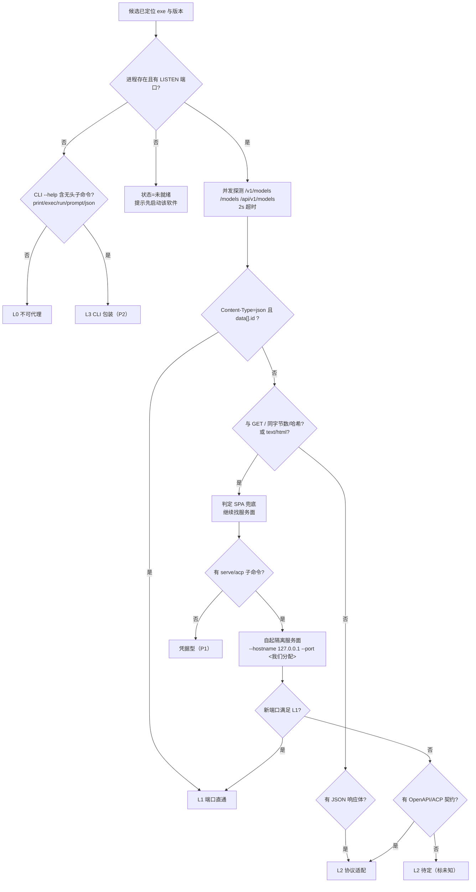

# 本地代理启动器（Agent Proxy Launcher）
## 可行性分析与项目规划报告

| 项 | 内容 |
|---|---|
| 报告版本 | v1.0 |
| 日期 | 2026-11-03 |
| 产品形态 | 通用型桌面工具（Windows 首发，macOS/Linux 设计到位、实现后排） |
| 一句话定义 | 把本机某个 agent 的模型能力，变成 `http://127.0.0.1:<port>/v1` 这样一个本机任何程序都能用的标准端点 |
| 结论 | **控制面可行（已实测跑通），数据面未闭合（2 个假设待验证）。建议进入 M0 技术闸门，不建议直接开工写产品。** |
| 配套文档 | `docs/01-prd.md`（v1，仅风险与竞品仍有效）、`docs/02-prd-delta.md`（**需求基线**）、`docs/03-architecture.md`（技术主干）、`docs/evidence-opencode-openapi.json`（上游契约原始证据，350,880 字节） |

---

## 1. 摘要

### 1.1 TL;DR

方向可行，且比原始设想更清晰：**不是"改 agent 的配置让它指向代理"，而是"把 agent 的服务面代理出来给别的程序用"**。Windows 上的"发现—分级—起端点—回收"整条控制链路，今天已能用真实软件跑通；但"一次请求真的穿到模型并逐 token 流回来"只走通了一半，卡在两个尚未验证的假设上。因此本项目的第一阶段不该是写功能，而是 **一次 6–9 人日的技术闸门（M0，双人并行约 3–5 天）**。

### 1.2 可行性分级

| 能力块 | 可行性 | 判断依据 |
|---|---|---|
| 候选发现（安装路径/版本/进程） | **高** | 注册表 + 进程 + 目录约定三源互补，实测命中 7 款软件 |
| 端口与凭据获取 | **中** | 有 `serve`/`service status` 子命令的软件可确定性取得；没有的只能靠 LISTEN→PID 反查 + 猜鉴权 |
| 可代理性分级（L0–L3） | **高（但有致命坑）** | 坑已定位并可廉价检测：Electron 的 SPA 兜底会把"200 但其实是 HTML"伪装成可用 |
| OpenAI 端点托管（`/v1/*` + SSE） | **高** | 纯工程量，无技术不确定性 |
| 非流式单次生成 | **中（链路通、无样本）** | M0 实测：请求真实抵达 provider 并返回结构化错误（429/502/400），协议链路成立；因免费额度用尽未取得文本 |
| 逐 token 真流式 | **低→中** | 事件通道 `/api/event` 可连（含 `: heartbeat`），但生成事件未取到；上游 stateless 端点本身不支持流 |
| `tool_calls` 转换 | **低（P0 明确不做）** | 上游契约里没有 OpenAI tool 形态，需自建状态机，属 P1 |
| 进程树回收（Electron 多进程） | **高** | Windows Job Object 是成熟方案，难点在"先挂作业再放行"的顺序 |

### 1.3 三个必须先做的决定

1. **M0 是 Go/No-Go 闸门，不是形式步骤。** 若拿不到一次真实文本返回，P0 就没有"端到端可跑"的样例，产品叙事要重写。
2. **技术栈先验证再定。** 本产品的护城河是"可靠地管住别人的进程和端口"，这部分全是 Win32 系统调用，选型错误会在 M2 才暴露，切换成本从 3 人日变成 20 人日。
3. **通用性承诺要拆成两档。** "新增一款软件 = 一份描述文件、不改主程序"在协议族内成立，跨协议族不成立（详见 §6.1 A1）。

---

## 2. 需求澄清：这个产品到底在代理什么

### 2.1 方向修正（关键）

| | 原设想（已废弃） | 当前需求（基线） |
|---|---|---|
| 数据方向 | 让 agent 指向本地代理，代理再转发到云 | **agent 作为能力提供方**，代理把它的能力向外暴露 |
| 受益者 | agent 自己 | **本机另一个需要模型的程序**（IDE 插件、脚本、另一个 CLI、自研程序） |
| 代理职责 | 改写配置、负载转发 | **协议适配 + 端点托管 + 鉴权 + 生命周期管理** |
| 典型拓扑 | consumer → 代理 → 云 | `Agent ⇄ 代理(127.0.0.1) → Consumer` |

```
┌──────────────── 上游 Upstream ────────────────┐
│  Agent GUI 客户端 / Agent CLI / 本地推理服务   │
│  持有：模型清单、凭据、编排与工具能力           │
└───────────────────┬──────────────────────────┘
                    │ 按等级适配（L1 直通 / L2 协议转换 / L3 CLI 包装）
        ┌───────────┴────────────┐
        │  本地代理 127.0.0.1:p  │  /v1/chat/completions · /v1/models
        │  鉴权 · 模型别名 · SSE │  并发 · 超时 · 脱敏审计
        └───────────┬────────────┘
                    │ OpenAI 兼容协议（下游看到的是标准端点）
┌───────────────────┴──────────────────────────┐
│  Consumer：IDE 插件 / 脚本 / 另一个 CLI / 自研 │
└──────────────────────────────────────────────┘
```

### 2.2 通用型的含义（三条硬约束）

| # | 约束 | 可验收项 |
|---|---|---|
| G1 | **不硬编码厂商**。扫描结果只是"候选"，不是白名单 | 删掉所有适配器文件后程序仍能启动并给出空列表 + "手动添加"入口 |
| G2-a | **协议族内扩展 = 纯描述文件**。新增同构软件只需投放 YAML，主程序零改动、不发版 | 放入新 YAML 即出现在列表并可代理 |
| G2-b | **新协议族 = translator 插件**，仍不改主程序内核 | `Translator` 接口先定形，P1 开放插件加载 |
| G3 | **可社区贡献**：模板 + 字段文档 + 单文件导入导出 + `maintainer/level` 标注 | 提供 `adapter-template.yaml` 与编写指南 |

> G2 的原始表述"任何新软件都只需一份描述文件"在字面上不可能成立——把 `{prompt}→{text}` 变成 OpenAI 流这件事本质是代码。强行塞进 YAML 会长成一门没人维护的配置 DSL。故拆为 G2-a / G2-b（决策记录见 §6.1）。

### 2.3 可代理性分级（产品的一等公民）

分级是**探测得出的建议值**，最终以适配器声明为准、用户可覆盖。

| 级别 | 含义 | 判定依据 | 用户可见 |
|---|---|---|---|
| **L0** | 不可代理 | 无 LISTEN 端口 + 无无头 CLI 子命令 + 需人工登录交互 | 灰显 + 具体原因 |
| **L1** | 端口直通 | `GET /v1/models` 返回 JSON 且满足 `data[].id` | 绿色「可直接接入」 |
| **L2** | 协议适配 | 有 HTTP 响应但非 OpenAI 形态（含"有 OpenAPI 契约"） | 黄色「可接入，需适配」 |
| **L3** | CLI 包装 | 无 HTTP，但 CLI 支持非交互单次调用 | 橙色「可用但性能有限」+ 实验性 |
| **EXCLUDED** | 明确不支持 | WSL 内的 agent（跨网络命名空间，见 §3.4） | 一次性说明 |

**分级的四条硬规则**（全部来自实测）：

1. `Content-Type: text/html` **一律否决 L1**，哪怕状态码是 200。
2. 响应体与 `GET /` **字节数/哈希相同 → 判定 SPA 兜底**，降为 L2 待定。这是最便宜的假绿判据。
3. 探测超时/无响应 → 标「未知」，**不判 L0 也不判 L1**。宁可承认不知道。
4. **绝不接管用户已有的服务面实例**，要代理就自己起隔离实例（独立端口 + `--standalone`）。

### 2.4 选择与启动的交互流程


每一步的用户可见反馈与失败出口：

| 步骤 | 用户看到 | 失败出口 |
|---|---|---|
| 扫描 | 渐进式出结果（快源先出，慢源异步补全） | 单源超时不影响其他源；空列表给"手动添加" |
| 列表 | 名称 / 版本 / **版本来源** / 置信度徽标 / 运行状态 | 置信度 <0.55 折叠为"可能的 agent，需你确认" |
| 选择 | 详情页：路径、进程、监听端口、适配器等级与原因 | 未运行 → 提示"先启动该软件"，不臆测分级 |
| 配置 | 端口（默认 8787，占用则递增）、上游、鉴权开关、模型别名表 | 端口被占 → 明确告知"被 <软件名> 占用" |
| 预检 | 逐项打勾：端口可用 / 上游可达 / 契约匹配 / 凭据有效 | 任一项红 → 给出单点修复建议，不进入启动 |
| 启动 | 3 秒内出端点，配置片段可一键复制 | 起不来 → 回滚已起进程，端口释放 |
| 运行 | 并发 / 错误率 / P95 / 首 token 延迟 / 用量 | 上游掉线 30–40s 内标红，**不允许"假绿"** |
| 停止 | "端口已释放 / N 个进程已结束"明细 | 端口仍在 TIME_WAIT → 如实说明并提供重试 |

消费者接入只需三行（端点就绪后由 UI 生成并复制）：

```
baseURL : http://127.0.0.1:8787/v1
apiKey  : sk-local-<首次启动生成，仅展示一次>
model   : <从模型清单复制别名>
```

---

## 3. 可行性分析

### 3.1 总体判断：控制面通、数据面半通

用"此刻这台机器上能不能"来检验（样本为 Windows 11 + 实测软件，仅作证据，不作范围）：

| # | 问题 | 诚实回答 |
|---|---|---|
| 1 | 能否发现本机 agent 并列出？ | **能**。注册表 + 目录约定 + 进程三源可用，实测 7 款 |
| 2 | 能否找到真实可用的服务端口？ | **能，但只对提供了服务面子命令的软件成立**（`service status` → `http://127.0.0.1:28894`，一行命令无歧义） |
| 3 | 能否拿到结构化模型清单？ | **能**。契约端点返回含 `capabilities`/`variants`/`cost` 的目录 |
| 4 | 能否端到端跑通一次模型调用？ | **不能确认**。契约存在，实测 60s 无返回（缺上游凭据）——这是唯一真正卡住 P0 的事实 |
| 5 | 能否逐 token 流式？ | **不能**。未取得任何增量事件，事件→chunk 的映射未验证 |
| 6 | DSH（Electron GUI 类）能否代理？ | **L0/L2 待定**。其 `0.0.0.0:3082` 是静态资源服务器（42KB HTML，`/v1/models` 等全 404） |

> 结论不是"可行性待验证"，而是"**M0 三天闸门**"。若两个假设都不成立，必须按 §5.3 的切换规则改路线（凭据型或 CLI 包装），并向用户重新解释产品定位。这个风险写在首页，不藏附录。

### 3.2 跨平台识别矩阵（重点）

#### 3.2.1 三平台 × 五类手段

| 手段 | Windows 11 | macOS | Linux |
|---|---|---|---|
| **① 安装路径** | 注册表 Uninstall 三视图（`HKLM\...\Uninstall`、`HKLM\...\WOW6432Node\...`、`HKCU\...`），取 `DisplayName/DisplayVersion/InstallLocation/DisplayIcon/Publisher`；`HKLM\SOFTWARE\...\App Paths\*.exe`（**直接给 exe 绝对路径，比 InstallLocation 可靠**）；`%LOCALAPPDATA%\Programs\*`；`%ProgramFiles%`/`%APPDATA%` 一层枚举；开始菜单 `.lnk`（COM `IShellLinkW::GetPath`）；`HKCU\...\Shell\MuiCache`（**绿色版唯一线索**） | `/Applications/*.app/Contents/Info.plist`（取 `CFBundleIdentifier/CFBundleShortVersionString/CFBundleExecutable`）；**`system_profiler SPApplicationsDataType -json`（macOS 的"注册表"，一次枚举全机）**；`mdfind`；Homebrew Caskroom；`~/Library/Application Support/<bundle-id>` 反推；`pkgutil --pkgs` | `/usr/share/applications/*.desktop` 与 `~/.local/share/applications`（解析 `Exec=`，需处理 `%f %U` 字段码与 `env A=B` 前缀）；`/opt`；包管理器 `dpkg-query`/`rpm -qf`/`snap list`/`flatpak list`；PATH 扫描 |
| **② 配置文件** | 用户 dotfile（`~/.config/<x>/`、`~/.<x>/`）、`%APPDATA%\<vendor>\`、`%LOCALAPPDATA%\<vendor>\`；**注意 Electron 会把真实配置塞进 `.electron-profile` 下的 LevelDB/SQLite，不可解析** | `~/Library/Application Support/<bundle-id>/`；`~/Library/Preferences/<bundle-id>.plist`（**必须用 `defaults read`，直接读文件会被 `cfprefsd` 缓存欺骗**）；`~/Library/Containers/`（沙盒） | `~/.config/<x>/`（**须尊重 `XDG_CONFIG_HOME` 而非硬编码 `~`**）、`~/.local/share/`、`~/.<x>/`、`/etc/<x>/`（只读） |
| **③ 进程** | `CreateToolhelp32Snapshot` 拿 `PROCESSENTRY32{pid, ppid, szExeFile}`（**只有文件名**）→ `OpenProcess(PROCESS_QUERY_LIMITED_INFORMATION)` + `QueryFullProcessImageNameW` 拿全路径 → 用 `ppid` 上溯到 `explorer.exe` 判主进程；`EnumWindows` 判"有可见窗口"；`ProcessIdToSessionId` 排除 session 0 | `proc_listallpids()` + `proc_pidinfo(PROC_PIDTBSDINFO)` 拿 ppid；**`proc_pidpath()` 拿全路径**（`ps` 的 comm 会截断到 16 字符）；`launchctl list` 识别 LaunchAgent 托管的常驻 CLI；归一化：`<App>.app/Contents/MacOS/<bin>` 与内嵌 Helper 都归到最外层 `.app` | `/proc/<pid>/exe`（**注意 `" (deleted)"` 后缀 = 已升级未重启，天然"建议重启"信号**）、`/proc/<pid>/cmdline`、`/proc/<pid>/status` 取 `PPid`；归一化 `/snap/<x>/...` → `snap:<x>`；**`/proc/<pid>/environ` 绝对不读**（含明文 API key） |
| **④ 版本** | **主：注册表 `DisplayVersion`**；备：`GetFileVersionInfoW` + `VerQueryValueW` 取 `VS_FIXEDFILEINFO`；备：路径片段（`cli\22.2.5-x64\`）；**禁用：安装目录下的 `version` 文件——那是 Electron 运行时版本** | `Info.plist` 的 `CFBundleShortVersionString`（用户可见版本，优先）> `CFBundleVersion`；`mdls -name kMDItemVersion`；Cask 目录名即版本；`<bin> --version` 兜底 | `dpkg -S <exe>` 反查所属包与版本（**最强**）；`rpm -qf`；`<bin> --version`（**2s 超时 + stdout/stderr 都收 + 正则抽第一个版本号**，很多 CLI 打到 stderr）；AppImage 文件名 |
| **⑤ 服务端口** | **`GetExtendedTcpTable(TCP_TABLE_OWNER_PID_LISTENER)`，AF_INET/AF_INET6 各一次 → 直接拿 `{addr, port, owningPid}`**，无需特权、不受本地化影响；端口→PID→exe 路径；`localAddr == 0.0.0.0` 说明已暴露局域网，UI 须提示 | `lsof -nP -iTCP -sTCP:LISTEN`（需权限）；程序内正确做法：`proc_pidinfo(PROC_PIDLISTFDS)` → `proc_pidfdinfo(PROC_PIDFDSOCKETINFO)` 取 `insi_lport`（**无需 root**） | `/proc/net/tcp{,6}` 解析：第 2 列 `HEXIP:HEXPORT` **小端序**、第 4 列 `0A`=LISTEN、第 10 列 socket inode；inode→PID 靠扫 `/proc/*/fd/*` 的 `socket:[inode]`（**无 root 唯一路径**）；有 root 时 `ss -ltnp` |

**取舍结论**：Windows 必做 `Uninstall 三视图 + %LOCALAPPDATA%\Programs + 进程全路径 + GetExtendedTcpTable + App Paths + MuiCache`，`.lnk` 解析可后排（MuiCache 已覆盖大部分曾运行场景）。macOS 一条 `system_profiler` 顶三条源。Linux 以 `.desktop` + 包管理器 + `/proc` 三件套为最大公约数。

#### 3.2.2 版本探测的三个陷阱（实测）

| 陷阱 | 现象 | 正确做法 |
|---|---|---|
| `version` 文件误导 | 安装目录下 `version` 内容 `44.7.0`，而应用真实版本是 `0.2.1-rc.5` | 该文件是 **Electron 运行时版本**，永不采用；以注册表 `DisplayVersion` 为准 |
| `InstallLocation` 为空 | 多款 Electron 软件注册表里安装位置为空 | 从进程 exe 全路径反查，并标记 `pathSource: process` |
| `app.asar` 内无明文版本 | 二进制包 grep 不到 `"version"` | 走注册表 / 文件版本资源 / 路径片段，冲突时按来源分级仲裁 |

#### 3.2.3 置信度模型与误判处理

每个候选携带 `sources[{kind, confidence, evidence}]`，总分取**单源最大值**（不是求和，避免"三个弱证据凑成强结论"）。

| 来源 | 置信度 | 呈现规则 |
|---|---|---|
| 注册表 Uninstall + 非空版本 + 路径存在 | 0.95 | ≥0.85 → 「已识别」，参与自动分级探测 |
| 注册表 + 进程路径补齐 | 0.90 | 同上，但标"路径来源=进程" |
| `App Paths` / `system_profiler` / 包管理器命中 | 0.90–0.95 | 同上 |
| `.desktop` 的 `Exec/TryExec` 指向存在文件 | 0.80 | 0.55–0.85 → 参与探测，结果标"推定" |
| `MuiCache` 曾运行记录 / dotfile 存在 / 进程反查 | 0.60–0.65 | 0.30–0.55 → 折叠"可能"，**不自动探测** |
| 目录命名约定 / 文件名关键词 | 0.15–0.35 | <0.30 默认隐藏 |

> 硬约束：**置信度 <0.55 的条目不得自动向其端口发任何 HTTP 请求**——不替用户探测身份不明的进程。

| 误判情形 | 处置 |
|---|---|
| 同名不同产品 | 去重主键 = **规范化 exe 绝对路径**，绝不按名字；macOS 另用 `TeamIdentifier` 区分发行方 |
| 绿色版无注册表 | `MuiCache` + 进程反查 + **手动添加（一等公民，可指定 exe/命令 + 自定义适配器）** |
| 多版本共存 | 同产品多版本分一行，展开选默认版本 |
| Electron 多进程同名 | 按路径去重→1 条；再按"有可见窗口/父进程为根"挑主进程 |
| 进程存活但 exe 已删 | 标 `stale` + "软件已升级，建议重启后再代理"，**不信任其端口** |
| 应用商店 reparse point | 解析 target；解不出则明确"暂不支持"，不猜 |

#### 3.2.4 WSL 内的 agent：结论是"不算本机，P0 排除"

三条理由任一即可否决：① WSL2 是 NAT 虚拟机，Windows→WSL 端口转发可被关、WSL→Windows `127.0.0.1` 多数配置不通，"本机"语义已变；② 进程由 WSL 实例托管（可能随终端关闭被终止），Windows Job Object 管不到 → **"停止即回收"无法保证**，违背 P0 硬验收；③ `\\wsl$` 路径不是 Win32 路径，`GetExtendedTcpTable` 看不到其命名空间内监听端口，要支持等于写第二套发现器 + 进程管理 + 网络桥接。

处置：显式检测（`/proc/version` 含 `microsoft`、`wsl.exe -l -v` 可执行），在 UI 给一次性说明，并归入第 5 种状态 `EXCLUDED`，不进 L0–L3。

### 3.3 配置文件探测：只读也要有纪律

产品在 P0 **不写**任何第三方配置（改了就变成"配置管理器"，与既有竞品正面撞车且引入写坏风险）。但"只读"本身有风险，故定 5 条：

| # | 原则 | 落实方式 |
|---|---|---|
| R1 | 只读、绝不写 | `FILE_SHARE_READ` / `O_RDONLY`；不建锁文件、不打时间戳、连 `.bak` 都不写 |
| R2 | 不解析含密钥的字段值 | 白名单字段名（`baseURL/api/provider/port/host`）；命中 `key\|token\|secret\|password\|credential` 的键**值不进内存**，只记"存在+长度" |
| R3 | 结构未知即降级 | 解析失败 / 结构不符 / >2MB → 只报"文件存在 + mtime"，标 `schemaUnknown`，不猜字段 |
| R4 | 不跨用户、不提权 | 只读当前用户目录；永不为了读配置请求 UAC/sudo |
| R5 | 凭据获取是独立能力 | 仅在适配器需鉴权时发生；只驻内存、封装 `SecretString`（不 `Clone`、不 `Serialize`、`Debug` 打码）、生命周期=本次上游会话；UI 只显示"已获取（43 字符）" |

> 架构上让泄漏"写不出来"：`ConfigProbe` 返回类型里没有裸 `String`，只有 `ConfigFinding { path, exists, size, mtime, schemaState, redactedKeys[], safeFields }`。类型系统比 review 更可靠。

### 3.4 代理的技术实现方式

#### 3.4.1 三条路线：不是实现差异，是三种产品

| 维度 | ① 通道型 | ② 凭据型 | ③ CLI 包装型 |
|---|---|---|---|
| 数据路径 | consumer → 代理 → **agent 服务面**（自带 server / ACP / OpenAPI）→ 模型 | consumer → 代理 → **直连上游 provider**（读 agent 的 baseURL+key） | consumer → 代理 → `spawn(agent --prompt --print)` |
| 复用了 agent 什么 | **编排、工具、MCP、会话、权限、系统提示** | 什么都不复用，只白拿地址与凭据 | 编排与工具都在，但每次冷启动 |
| 流式 | 真流式（若上游有 SSE/ACP 增量） | **最真**（原生 SSE） | 只能伪流式 |
| 稳定性 | 中（依赖常驻、协议可能随版本变） | **高** | **低**（参数/输出格式/登录态都易变） |
| 性能 | 中（多一跳编排，首 token 可能被系统提示拖慢） | **高** | 低（每次冷启 1–5s） |
| `tool_calls`/`usage` | 基本拿不到 OpenAI 形态 | **原生有** | 无 |
| 对定位的贡献 | **正**（"把 agent 的能力放出去"字面成立） | 偏（agent 沦为"密码本"） | 中（体验退化） |

#### 3.4.2 选型决策树（按客观特征判定，不看厂商名）



#### 3.4.3 P0 走哪条：通道型，且优先落在"自带服务子命令"

| 路线 | P0 地位 | 说明 |
|---|---|---|
| **通道型** | **P0 唯一可用路线** | `spawn(agent serve --hostname 127.0.0.1 --port <我们分配>)` → 有序契约面 → 一个 translator 转 OpenAI。**必须自起实例、必须自定端口**，否则无法保证"停止即回收" |
| L1 直通 | P0（顺带实现） | 就是同一个 translator 的 identity 分支，零额外成本 |
| 凭据型 | P1 | 见下 |
| CLI 包装 | P2 | 最脆，且无真流式 |

**为什么凭据型不进 P0**（三条）：

1. **不可靠，且恰在最需要兜底时失效。** 实测：服务配置文件里只有 `password` 没有端口；上游配置被改名成 `.imported`；某家全局状态 JSON 已 632KB；竞品配置已从 JSON 演化成 SQLite。"配置即数据库"是趋势，读配置拿 baseURL+key 的半衰期以"上游一次升级"计。
2. **改掉了产品叙事。** 不经 agent 编排 → `tool_calls`/系统提示/MCP 全丢，等于"用 agent 的 key 直连上游"——那用户为什么不直接改环境变量？正好撞进竞品护城河。
3. **承担凭据与条款两类风险，却零收益**（P0 只需 1 个样例，样例由通道型提供）。

但要在 translator 抽象里**预留** `credential-passthrough` 族与 `upstream.direct` 字段，P1 接入时不改 schema（改 schema 会破坏社区适配器生态的向后兼容）。

#### 3.4.4 最小可行 L2 切片（MVP-L2）

保留 6 条，一条不多：

| # | 保留 | 理由 |
|---|---|---|
| 1 | 只做 `POST /v1/chat/completions` **非流式** | 上游无状态端点天然是 `{prompt}→{text}`，唯一已确认契约成立的路径 |
| 2 | `GET /v1/models` | 上游目录几乎可透传 |
| 3 | `stream:true` → **伪流式**（分块回放 + `[DONE]`） | 保证接口形状成立、consumer 不报错；**但必须在 UI 与文档标注"上游不支持真流式，当前为分块回放"** |
| 4 | 只支持单轮无状态：`messages` 压平成 prompt，每请求新会话 | 避免污染用户正在用的会话（红线） |
| 5 | `tools`/`response_format`/`n`/`logprobs` **显式 400 拒绝** | 静默忽略 = agent 拿到残缺上下文还返回结果，比报错危险 |
| 6 | `usage` 用估算值 + 显式 `usage_estimated: true` | 不伪装精确 |

砍掉：真流式（M2 stretch）、`tool_calls` 转换（P1）、embeddings（P1）、多轮复用（不做）、多实例（P1）、自动拉起 GUI（不做）、macOS/Linux（P2）。

#### 3.4.5 协议适配的关键细则

| 项 | 规定 |
|---|---|
| 模型别名 | 下游只见**别名**，上游真实 id 内部使用；支持 `provider/model` 与裸 `model` 双向解析；上游改名不影响下游配置 |
| `messages` 压平 | `[system]…[/system]`、`[user]…[/user]` 标签包裹；多条 system 合并；多模态只取 text，`image_url` → 400；最后一条须为 user |
| SSE 分帧 | `data: <json>\n\n`（双换行）；首帧带 `role`；末帧 `finish_reason`；`data: [DONE]` 后立即关闭；15s 心跳注释行；**不产生 `\n\n\n`**（部分解析器会断） |
| 背压与取消 | 有界 channel（64）；consumer 断开 → **立即 abort 上游**（否则上游继续生成继续烧额度） |
| 会话语义 | `stateless`（默认）> `per-request`（建→用→删）；**`shared-session` 永不采用**（会与用户会话互串） |
| 非标字段 | `reasoning_content` 默认透传（丢弃=静默丢功能）；提供 `strictOpenAICompat` 开关；其余厂商字段白名单透传 |
| 不支持端点 | `embeddings`/`legacy completions`/`images`/`audio` → `501 apx_unsupported_endpoint` |
| 错误语义 | 统一 OpenAI 信封，自研码放 `error.code`（`apx_unsupported_field`/`apx_upstream_unreachable`/`apx_upstream_rate_limited`/`apx_adapter_stale` 等）；**任何错误都不回显上游 key**（构造时即 redaction，`SecretString` 不实现 `Display`） |

#### 3.4.6 端口与生命周期

| 项 | 做法 |
|---|---|
| 动态端口 | `bind("127.0.0.1", 0)` → 立刻读端口 → **不 drop，直接交给 server**（消除 TOCTOU）；默认 8787，占用则递增，全占回落 `bind(0)` |
| 端口冲突提示 | 反查占用 PID → exe → 告诉用户"被 <软件名> 占用"，而不是"端口被占用" |
| 自动拉起 | **不拉起用户 GUI**（带登录态、会抢焦点）；但允许拉起"我们自己的隔离服务面实例"（显式点击 + 独立端口 + Job Object 内） |
| 停止即回收 | drain 在途 → 关闭 listener（端口立即可复用）→ 杀进程树 → 轮询验证"connect 被 refuse" |
| Windows 回收 | `CreateJobObjectW` + `JOB_OBJECT_LIMIT_KILL_ON_JOB_CLOSE`；子进程 **`CREATE_SUSPENDED` → assign → resume**（顺序错就有逃逸窗口） |
| POSIX 回收 | `process_group(0)` + `killpg(SIGTERM)` → 3s → `SIGKILL`；Linux 加 `PR_SET_PDEATHSIG` |
| 孤儿清理 | pidfile 记 `{pid, exePath, processStartTime, port}`；**三条件全满足才 kill**，否则只删文件不动进程（宁可留僵尸端口，不误杀用户进程） |

#### 3.4.7 安全

| 项 | 设计 |
|---|---|
| 下游鉴权 | `sk-local-` + 32 字节 CSPRNG，存 OS keystore（DPAPI / Keychain / Secret Service），**只在 UI 完整展示一次**；常量时间比较；可重置（在途 SSE 不断）；可关闭但需二次确认 + 常驻红条 |
| 为什么 token 同时是 CSRF 防线 | 带 `Authorization` 的跨域请求属"非简单请求" → 必先 `OPTIONS` 预检 → 我们不返回 `Access-Control-Allow-*` → **预检失败，请求根本发不出去** |
| CORS | **默认全拒绝**，不做白名单；`Origin: null`（file:// / 沙盒）拒绝；`Sec-Fetch-Site: cross-site` 直接 403 |
| UI 与 consumer 分离 | 控制面走独立 admin 端点 + 独立 token（或 stdio JSON-RPC），**绝不为 UI 给 `/v1/*` 开 CORS 口子** |
| 绑定地址 | 默认 `127.0.0.1`；改 `0.0.0.0` 需**手输** + 二次确认 + 检测到 `cloudflared/ngrok/frpc/tailscale` 时阻断；校验上游不得指向自身端口或系统代理（防环回/双重代理） |
| 日志 | 只记元数据（时间/模型/状态码/耗时/用量来源），**不记 prompt 与响应正文**；路径中的用户名打码；验收用金丝雀串全盘 grep |

### 3.5 技术栈选型

| 方案 | 包体积 | 常驻内存 | 进程/端口管理 | HTTP+SSE | 结论 |
|---|---|---|---|---|---|
| **Tauri 2（Rust core + React UI）** | **8–15MB** | **40–90MB** | ★★★★★ Win32 一等公民绑定 | ★★★★★ | **推荐** |
| Electron + Node | 90–150MB | 150–300MB | ★★☆ 需 native addon 或 shell 出 `powershell` | ★★★★☆ | 仅当团队纯 JS |
| Go + Wails v3 | 15–25MB | 60–120MB | ★★★★☆ | ★★★★☆ | **可接受备选** |
| 纯 Go CLI + 本地 Web UI | 8–12MB | 40–80MB | ★★★★☆ | ★★★★☆ | 若放弃托盘/桌面感 |

**结论：Tauri 2 + React/MUI/Tailwind**，三条决定性理由——① 产品核心价值在"可靠管住别人的进程和端口"，这些全是 Win32 系统调用（Job Object、`GetExtendedTcpTable`、`QueryFullProcessImageNameW`、注册表、文件版本）；② SSE 背压与取消传播需要精确的内存与时序控制（`tokio` + 有界 channel + `CancellationToken`）；③ 12MB 与 130MB 对"本地小工具"是信任问题。

**代价与对冲**：Rust 曲线 → M0 先写 <300 行探针把"杀进程树 + 端口归属 + SSE 背压"跑通；团队确定无人会 Rust 则**直接 Go + Wails v3，不要用探针去赌**。

### 3.6 进程结构：core + UI 双进程

| 方案 | 结论 | 理由 |
|---|---|---|
| 单体（UI 进程内跑代理） | ❌ | UI 崩溃 → 上游变孤儿，违背"停止即回收"；无法 headless 测代理 |
| **core + UI 双进程** | ✅ | 崩溃隔离；core 可 `--headless` 跑集成测试；回收责任明确；未来 CLI/服务化复用同一 core |

IPC：UI 作为父进程 spawn core，走 **stdio JSON-RPC**（无端口、无防火墙、无鉴权问题、生命周期天然绑定）；多开场景 core 写 `admin.json{port,token,pid}`，UI 用独立 admin token 连接，与 consumer token 完全隔离。

---

## 4. 风险与限制

### 4.1 技术风险（按杀伤力排序）

| # | 风险 | 触发条件 | 影响 | 缓解 |
|---|---|---|---|---|
| **N5** | **假绿 / 适配失效** | SPA 兜底返回 200 HTML；上游升级改端点/端口/字段 | 代理显示"运行中"但实际不可用——**比报错更坏** | 三级否决（content-type / 与 `/` 同构 / JSON 解析）+ 20s 周期探测 + 连续 2 次失败标红 + `system_fingerprint` 带适配器版本 |
| **N6** | **越权：本机任意进程/网页白用额度** | 端点无鉴权；**浏览器里任意网页的 JS 也能打 localhost**；误绑 `0.0.0.0` | 烧额度、扩散到局域网 | 默认强制 token + CORS 全拒绝 + `Sec-Fetch-Site` 校验 + 绑 `0.0.0.0` 需手输确认 + 隧道进程检测阻断 |
| **N1** | 上游协议不标准 | 不支持 `tool_calls`/`stream`/`reasoning_content`/多 system | 下游报错或**静默丢功能** | 能力声明表 + 不支持字段**显式 400**（不静默忽略）+ 可安全忽略者用 `x-apx-degraded` 头 |
| **N2** | 限流与额度耗尽 | 下游并发高 / 上游有 QPS 或日额度 | 429；严重时**烧光付费额度且无感知** | 透传 429+`Retry-After`、每 consumer 并发上限、断连即 abort、用量可见 + 阈值告警 |
| **N4** | consumer 兼容性长尾 | 各家对 SSE 边界、`[DONE]`、空行、增量拼接容忍度不同 | 某个 consumer 收不到流，另一个正常——极难定位 | 严格对齐 OpenAI schema + `insta` 快照固化 + 3 种 consumer 冒烟清单 |
| **N7** | 单实例阻塞放大 | 上游串行，一个慢请求拖住全部 | 下游整体超时 | 每请求硬超时 + 有界队列 + 满则 503 快速失败 + 无全局锁 |
| **N3** | GUI agent 无 API 面 / L3 脆弱 | 只能靠 CLI 或逆向内部通道 | UI 改版即失效；可能污染用户会话 | P0 不做 L3；**禁止 shared-session**；L3 必须实验性标识 + 硬超时 + 不触碰用户会话 |

### 4.2 合规与产品风险

| # | 风险 | 缓解 |
|---|---|---|
| C1 | 修改第三方软件配置可能违反其许可/条款 | P0 **不写配置**，只读 + 接入指引（用户手动粘） |
| C2 | 凭据型路线绕开 agent 编排，可能触及上游服务条款 | 不进 P0；若 P1 做，需用户显式授权 + UI 声明"未复用 agent 编排" |
| C3 | 逆向 GUI 私有接口/注入/CDP 深改 | 明确列入 Out of Scope；仅允许适配器显式声明的 L3 路径 |
| P1 | 上游版本升级导致适配集体失效 | `testedWith` 版本区间 + 契约校验 + 失效标红 + 适配器版本诊断 |
| P2 | 竞品已覆盖"切换配置" | 差异化锁在"探测 + 分级 + 端点托管"，不碰配置管理 |
| P3 | 用户误以为"代理 = 免费额度" | 首次使用明确提示"消耗的是你 agent 账号的额度" |

### 4.3 明确的边界（不做什么）

云端账号/订阅/密钥托管 · 模型路由计费 · 逆向破解或绕过授权校验 · prompt 内容分析/改写/缓存 · **跨机器共享代理（局域网/公网暴露）** · 模型效果评测与路由选优 · 改写第三方配置（P0） · WSL 内 agent（P0） · 自动拉起用户 GUI（P0）。

---

## 5. 项目规划

### 5.1 功能范围

**P0（单里程碑可交付，11 项）**

| ID | 功能 | 验收 |
|---|---|---|
| P0-1 | manifest 适配器机制（外挂目录 + schema 校验 + 故障隔离） | 放入新 YAML 即生效，主程序零改动 |
| P0-2 | 候选发现 + 手动添加 | 未识别软件可手动入库并持久化 |
| P0-3 | 可代理性探测 L0–L3 + 原因链 | 四级各有可复现判定样例；"未知"独立标记 |
| P0-4 | **至少 1 个真实可跑的 agent 适配器** | consumer 调用 → 上游真实返回（见 §6.2 红线） |
| P0-5 | 本地端点 `/v1/models`、`/v1/chat/completions` + SSE | 官方 OpenAI SDK 直连可用 |
| P0-6 | 模型清单四列 + 一键复制 | `/v1/models` 与实际可调用一致 |
| P0-7 | 消费者接入指引 + 自检 curl | 3 分钟内接通 |
| P0-8 | 健康检查 / 停止即回收 | 停止后端口立即释放、无残留进程；上游掉线 30–40s 标红 |
| P0-9 | 下游鉴权（默认开、可关） | 无 token → 401；token 可重置 |
| P0-10 | 日志脱敏 | 日志无明文 key、无对话内容 |
| P0-11 | 错误语义化 | 可区分「上游不支持/不可达/限流/超时」 |

**P1**：适配器模板库与社区导入导出 · L2 协议增强（`tool_calls`、`reasoning` 透传、system 兼容）· 模型别名批量管理 · 并发与按 consumer 限流 · 用量统计 · 多实例并存 · 上游自动拉起 · 凭据型适配器。

**P2**：L3 CLI 包装 · 配置改写与回滚 · 托盘/开机自启 · macOS/Linux 实现 · 按模型分流多上游。

### 5.2 模块划分

| 层 | 模块 | 职责 |
|---|---|---|
| **控制面** | Tauri UI（列表/详情/运行态/适配器/设置）、Admin API（loopback + 独立 token） | 交互、展示、指令下发 |
| **编排** | ProxyController（start/stop/restart 状态机）、ServiceFaceSupervisor（spawn + Job Object + pidfile）、HealthMonitor（周期探测 + 假绿判定） | 生命周期与健康 |
| **代理运行时** | ProxyServer（axum/hyper + SSE）、AuthGuard/CorsGuard、ConcurrencyLimiter、UpstreamClient（连接池 + 取消传播）、errors | 端点托管与协议出口 |
| **适配层** | ManifestLoader（schema + 热加载 + 隔离）、TranslatorRegistry、5 个 translator（openai-passthrough / http-openapi / acp / http-custom / cli-headless）、ModelCatalog | 通用性的核心 |
| **发现层** | DiscoverySource（registry/process/convention/package/desktop-entry）、AppResolver（规范化 + 去重 + 置信度）、CapabilityProbe（端口/响应体形态/SPA 兜底/CLI help） | 跨平台识别 |
| **横切** | SecretString/keystore、AuditLog（结构化 + 脱敏）、ConfigStore、Platform（Win32/POSIX 抽象） | 安全、审计、可移植 |

**manifest 是通用性的骨架**：只描述"是什么、怎么找、怎么连"（匹配规则、版本来源、`serviceFace.type`、端口获取策略、凭据来源、健康检查、能力位、会话策略），**不描述"怎么翻译"**——翻译属 translator 代码。完整 schema 见 `docs/03-architecture.md` §D.4.2。

### 5.3 开发阶段与里程碑

| 里程碑 | 目标 | 关键交付 | 依赖 | 人日 |
|---|---|---|---|---|
| **M0** 技术闸门 | 闭合 3 个假设，决定 Go/No-Go | ① Rust 探针（Job Object + TcpTable + SSE）② **Go 最小对照探针** ③ 上游数据面探针 ④ 结论备忘（含两行对照结论） | — | **6–9** |
| **M1** 发现 + 清单 | 能列出本机 agent（版本/路径/置信度） | 发现层多源 + AppResolver + 手动添加 + 列表 UI | M0 | 8–12 |
| **M2** 代理运行时 | consumer 用标准协议打通上游 | manifest + 2 个 translator + `/v1/*` + SSE + 错误码 + 鉴权 + 脱敏 + 回收 | M0、M1 | 16–22 |
| **M3** 控制面 + 安全 | 3 分钟接通；N5/N6 全项可验收 | 详情页 + 预检 + 复制片段 + 运行态 + 假绿标红 + CORS/Origin + 审计 | M2 | 10–14 |
| **M4** 打包分发 | 可分发给真实用户 | 安装包 + 签名 + 自动更新 + 崩溃上报 + 多平台评估 | M3 | 8–12 |

合计 **48–69 人日**（单人）；两人并行（M1 与 M2 可部分并行）日历约 **7–9 周**。

**M0 的三个假设与失败切换**（这是本报告最重要的一张表）：

| 假设 | 通过判据 | 不通过 → 换什么 |
|---|---|---|
| **H1 服务面可程序化取得**（确定性端口 + 可用凭据） | 三条路径 ≥2 条成立，且"端口由我们指定"必须成立 | 退到 LISTEN→PID 反查 + 凭据从 stdout/文件；连端口都不确定 → 该软件 L2 不可达，换软件或降 L3 |
| **H2 数据面可达**（一次真实文本返回） | 30s 内拿到非空 `text` | 换"建会话→prompt→读结果"再试；两路都不通 → **P0-4 无样例**，按 §6.2 诚实降级 |
| **H3 增量流可达** | 单次请求收到 ≥3 个增量事件且能拼成完整文本 | **不阻塞 P0**：降级伪流式，但 `streaming:false` 必须如实上报、UI 明确标注 |

**M0 退出条件**：产出 `docs/m0-spike-report.md`，逐条写"假设—证据（原始命令与输出）—结论—后续路线"。**没有这份报告，不进 M1。**

### 5.4 依赖清单

| 端 | 依赖 |
|---|---|
| Rust core | `tokio`、`axum`/`hyper`、`reqwest`(rustls)、`windows`（JobObjects/IpHelper/Threading/Registry/FileSystem）、`serde`/`serde_json`/`serde_yaml`、`jsonschema`、`notify`、`uuid`(v7)、`tracing`、`subtle`、`rand`+`base64`、`keyring`、`thiserror`/`anyhow`、`tokio-util`(CancellationToken)、`regex`、`globset`、`sysinfo`(兜底) |
| Tauri 外壳 | `tauri` 2.x、`tauri-plugin-updater`、`tauri-plugin-single-instance` |
| 前端 | React 18 + TS + Vite + MUI 5 + Tailwind、`@tanstack/react-query`、`zustand`、`@tauri-apps/api` |
| 测试 | `cargo-nextest`、`insta`（分级判定快照）、`wiremock`（假上游）、`openai` Python SDK（冒烟） |

### 5.5 预期难点 Top 8

| # | 难点 | 为什么难 | 应对 / 降级 |
|---|---|---|---|
| 1 | **"有端口"≠"有 API"，SPA 兜底伪装成 200** | 实测某个 Electron 应用把 `/v1/models`、`/models`、`/config` 全部返回 `200 text/html` 且字节数完全相同；若按"200 即 L1"实现，会把**每一个 Electron 应用**都误判为可直连 | 三级否决 + 三种形态夹具的快照测试固化 |
| 2 | **端口与凭据是动态的，配置文件不可信** | 配置文件只有 password 没有端口；上游配置被改名；部分配置已演化成 SQLite | 端口优先级 `launch-assigned > cli-command > listen-scan > static`；**永远优先自起实例自定端口** |
| 3 | **流式语义不一致** | 下游要逐 chunk，上游无状态端点是一次性返回；真流式只能走事件通道 + 会话过滤 + 增量拼接 | 双轨：真流式 / 伪流式；**UI 必须如实标注**，不骗用户 |
| 4 | **`tool_calls` 双向转换** | 上游无 OpenAI tool 形态；需维护函数调用状态机 + 稳定 index + 参数 JSON 片段合并（中间态可能非法） | P0 显式拒绝；P1 先只做非流式 |
| 5 | **会话语义不匹配** | OpenAI 无状态 vs agent 有状态；复用会污染用户会话 | `sessionPolicy` 三档，`stateless` 优先，禁 `shared-session` |
| 6 | **跨平台进程树回收** | Electron 一起 5–8 个同名进程；杀父留孤儿继续占端口；Windows 无进程组 | Job Object + `CREATE_SUSPENDED` 先挂后跑；POSIX 进程组 + SIGTERM→SIGKILL；pidfile 双保险 |
| 7 | **通用性与正确性的张力** | "一份 YAML 适配一切"不可能，把翻译塞进 YAML 会长成不可维护 DSL | 拆 G2-a/G2-b；P0 内置 5 个 translator，trait 先定形 |
| 8 | **"停止即回收"的确定性** | `TIME_WAIT` 影响端口复用；"父死子死"在某些宿主只是偶然成立 | 关闭顺序固定；验证用"connect 被 refuse"而非查 netstat；超时如实说明 + 一键重试 |

---

## 6. 决策记录与待确认

### 6.1 已裁定（交付总监）

| # | 议题 | 裁定 | 理由 |
|---|---|---|---|
| A1 | G2"新增软件=一份描述文件、不改主程序"是否拆分 | **接受拆为 G2-a（协议族内=纯 YAML）/ G2-b（新协议族=translator 插件）**，PRD 原文保留并标注"由架构评审修订" | 逐字实现不可能；强行实现会得到一门没人维护的 YAML DSL |
| A2 | 若 H2 不成立，P0-4 验收能否降级 | **允许降级为"机制可用性证明"或"凭据型样例 + 显式标注未复用编排"**；**Ollama 只能作 L1 管道冒烟夹具，任何情况下不得充当 P0-4 交付证明** | 宁可少一条承诺，不可交付一个"看起来跑通"的假象 |
| A3 | 技术栈是否可直接选 Go | **保留 3 人日 Rust 探针，同时并行 1 人日 Go 最小对照探针**；团队确定无人会 Rust 则直接 Go + Wails v3 | 只有对照过，结论才是"Rust 行/不行"，而不是"我们没写出来" |
| A4 | 是否改写第三方配置 | **P0 不改写，仅只读 + 接入指引** | 避免变成"配置管理器"与竞品正面撞车，同时消除写坏风险 |

### 6.2 P0-4 的显式红线

> **P0-4 必须由真实 agent 软件打通的链路来证明。** 允许用本地推理服务（天然 OpenAI 兼容）验证代理管道本身，但它只能叫"L1 冒烟夹具"，**不得出现在"P0-4 已交付"的结论里**。若 M0 后仍拿不到真实 agent 的一次文本返回，唯一诚实的做法是：把 P0-4 改为"机制可用性证明"，并在 UI 与文档中写明"当前样例未复用 agent 编排"。用替代品充数会让整份可行性判断失去意义。

### 6.3 待用户拍板

| # | 问题 | 选项 | 建议 | 影响 |
|---|---|---|---|---|
| Q1 | 首发平台 | A 仅 Windows / B Windows+macOS | **A** | macOS 无注册表，发现层需重做 |
| Q2 | 下游鉴权 | A 默认强制 token + 严 CORS / B 默认无鉴权 / C 强制且不可关 | **A** | 直接决定 N6 风险等级 |
| Q3 | 首发是否做 L3 CLI 包装 | A 不做 / B 做 1 个样例 | **A** | L3 最脆、最拖里程碑 |
| Q4 | 上游未运行时是否自动拉起 | A 仅提示 / B 按声明自动拉起 | **A** | 自动拉起涉及登录态与副作用 |
| Q5 | 多轮上下文 | A 无状态（每次压平 prompt） / B 复用会话 | **A** | B 会与用户正在用的会话互串 |
| Q6 | 是否接受"伪流式"作为 P0 交付 | A 接受并如实标注 / B 要求真流式才发版 | **A** | 选 B 会把 M2 拉长一个量级 |

---

## 7. M0 实测结果（报告落盘后已执行）

> 完整证据与命令见 `docs/m0-spike-report.md`；可运行原型见 `prototype/`。

| 假设 | 判据 | 实测 | 判定 |
|---|---|---|---|
| H1 服务面可程序化取得 | 端口由我们指定 + 凭据可程序化获取 | `serve --hostname 127.0.0.1 --port 18787` 打印 `server listening on …:18787` 与 `server password <43 字符>` | ✅ 通过 |
| H2 数据面可达 | 30s 内拿到非空文本 | 请求抵达 provider，返回 429 `rate_limit`（额度用尽）/ 502 代理隧道 / 400 隐私策略；无成功文本 | ⚠️ 链路通、无样本 |
| H3 增量流可达 | 单次请求 ≥3 个增量事件 | `/api/event` 可连并收到 `server.connected`，无生成事件 | ⚠️ 通道可达、增量未验证 |

### 7.1 四条改变设计的实测事实

| # | 事实 | 对设计的影响 |
|---|---|---|
| 1 | **就绪 ≠ 端口可连**：自起实例约 15–20s 完成插件激活，期间契约端点返回 503 `Location plugins did not finish activating`；而根路径从一开始就是 200 的 HTML | 就绪判定必须是"契约端点 200"，否则会拿到"假就绪" |
| 2 | **鉴权不是 Bearer**：该上游是 `Basic base64("user:password")`，`Bearer` 返回 401 | 鉴权方案必须由适配器声明，主程序不得假设 |
| 3 | **上游会继承系统代理**：本机 `HTTP_PROXY` 使某 provider 报 `502 ERR_PROXY_TUNNEL` | 必须提供"上游是否继承系统代理"的开关，否则在有代理的机器上必然失败 |
| 4 | **能力因 provider 而异**：同一实例下 148 个模型分属 3 个 provider，失败原因各不相同（额度 / 代理 / 策略） | 模型清单必须带"来源 + 可用性"，错误必须能区分四类而非笼统 502 |

### 7.2 另一份实践给出的两条经验（已落到实现里）

> 「这类代理的难点从来不是转发，而是**凭证生命周期**和**流式语义**——前者决定它能不能长期活着，后者决定用户觉不觉得快。」

| 主题 | 教训 | 落地方式 | 验证 |
|---|---|---|---|
| 凭证生命周期 | token 由宿主应用刷新（约 30 天），启动读一次会静默失效 | 凭证**不缓存**，每请求现取；SQLite 只读 + `busy_timeout`；401 时强制重读并重放一次（仅非流式）；`/healthz` 报 `credential.ok/hasToken/expiresAt` | 测试：轮换 token 文件后不重启，上游收到新 token；上游拒绝一次后代理重放成功（上游被请求 2 次） |
| 流式语义 | **绝不能先读完整再转发**，否则首字延迟从 0.5s 变 8s；SSE 必须逐块 flush；有的上游不发 `[DONE]`；客户端断连要取消上游 | `reader.read()` 循环逐块 `res.write()`；尾部检查补 `[DONE]`；`res.on('close')` → `cancel()` + `abort()`；上游不支持真流式时降级并标 `x-apx-degraded` | 测试：假上游每 60ms 吐一块，首块 <400ms、帧数 ≥3、含 `[DONE]`，且首块与结束相差 >100ms |

### 7.3 对交付口径的影响

| 项 | 调整 |
|---|---|
| P0-4 验收 | 改为**两段式**：① 机制可用性（端口/凭据/契约/鉴权/映射/错误归一，**已达成**）② 真实文本返回（需用户提供有额度的上游，**未达成**） |
| 流式 | P0 交付"伪流式 + 显式标注"；真流式排 M2 stretch |
| 技术栈 | 本机无 Rust/Go，原型用 Node 零依赖实现；Tauri 版待工具链就绪 |

---

## 8. 附录

### 8.1 本机环境样本（仅作证据，不构成范围）

| 观察项 | 事实 |
|---|---|
| 注册表可读性 | 命中 7 款：某 Agent GUI 0.2.1-rc.5（`InstallLocation` 可用）、某 Code 客户端 2.2.5/3.14.3/3.0.57（`InstallLocation` 为空）、本地推理服务 0.34.3、某模型工作台 0.3.13 |
| 进程特征 | Electron 应用同时 5–8 个同名进程；按名字计数必错 |
| 端口特征 | 某 GUI 应用监听 `0.0.0.0:3082`，`GET /` 返回 42,896B HTML，`/v1/models` 等全 404 → **有端口≠有 API** |
| 配置文件 | `service.json` 仅含 `password`（43 字符，无端口）；上游主配置被迁移为 `.imported` |
| 鉴权特征 | 对契约端点用 `Bearer` → 401；用 `Basic base64("user:password")` → 200 |
| 契约可得性 | 有凭据时 `GET /openapi.json` 返回 350,880 字节规范，已归档为 translator 单测夹具来源 |
| 竞品现状 | 本机已有配置切换类工具，且其设置项里已含"本地代理"开关 → 差异化必须锁在探测/分级/端点托管 |

### 8.2 可复现的验证命令（节选）

```bash
# 拿到真实 exe 路径（注册表 InstallLocation 为空时的唯一办法）
ls "$LOCALAPPDATA/Programs/<vendor>/<app>.exe"

# 服务面能力
"$CLI" --help          # serve / acp / api / models / service / run
"$CLI" serve --help    # --hostname --port --cors --standalone
"$CLI" service status  # → http://127.0.0.1:<port>

# 假绿证据：全部 200 且字节数完全相同 = SPA 兜底
for p in / /v1/models /models /doc /config; do
  curl -s -o /dev/null -w "$p %{http_code} %{content_type} %{size_download}\n" "http://127.0.0.1:<port>$p"
done

# 真 API 面 + 鉴权方式
curl -s "http://127.0.0.1:<port>/openapi.json"                     # 401 application/json
curl -s -H "Authorization: Bearer $PW" .../openapi.json            # 401（Bearer 不行）
curl -s -H "Authorization: Basic $(printf 'user:%s' "$PW" | base64)" .../openapi.json -o openapi.json
```

### 8.3 交付物清单

| 文件 | 内容 |
|---|---|
| 本报告 | 可行性结论 + 跨平台识别 + 代理实现 + 风险 + 项目规划 + 决策记录 |
| `docs/01-prd.md` | v1 PRD（风险清单 20 条、竞品分析、需求追踪矩阵仍有效） |
| `docs/02-prd-delta.md` | **需求基线 v2**：方向修正、G1–G3、L0–L3、P0 十一项、N1–N7 |
| `docs/03-architecture.md` | 技术主干：证据分级、识别矩阵细节、三条路线、manifest 完整 schema、文件结构、里程碑验收、风险映射 |
| `docs/evidence-opencode-openapi.json` | 350,880 字节上游 OpenAPI 契约，可用于生成 translator 与单测夹具 |
| `docs/diagrams/*.mermaid` | 5 张可独立渲染的图：架构总览、类模型、决策树、流式请求时序、停止回收时序 |
| `docs/m0-spike-report.md` | **M0 闸门报告**：H1/H2/H3 判定、真实命令与输出、两条经验落地、对计划的影响 |
| `prototype/` | **可运行原型**（Node 零依赖）：发现层、L0–L3 分级、适配器、OpenAI 端点、凭据生命周期、流式透传、22 项测试 |

### 8.4 建议的下一步

1. ~~做 M0~~ **已执行**（见 §7）：H1 通过、H2 链路通但缺成功样本、H3 未验证。
2. **补齐 H2 的成功样本**：需要用户侧提供有额度的上游（恢复免费额度或指定付费 provider）。这是纯环境问题，不阻塞代码。
3. **验证增量映射**（H3）：拿到成功样本后，验"事件 → 过滤 → 拼接 → OpenAI chunk"。
4. **补"上游代理策略"开关**：实测系统代理会让上游 502，必须能让用户选择 清除 / 继承 / 指定。
5. **技术栈决策**：本机无 Rust/Go，原型用 Node 跑通；若要转 Tauri，先做 3 人日 Rust 探针 + 1 人日 Go 对照。
6. **定 Q1/Q2**（首发平台、鉴权默认值），影响 M1 模块划分。
